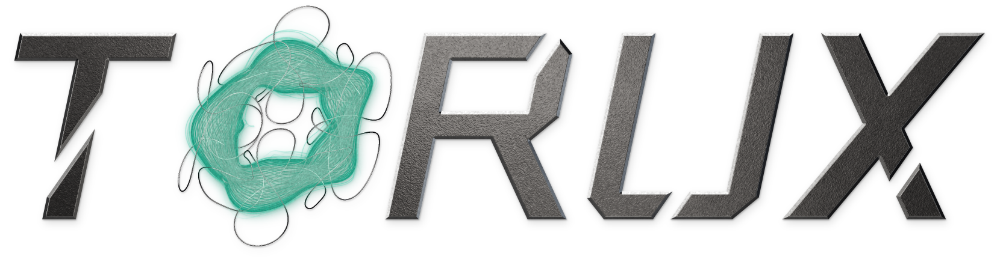
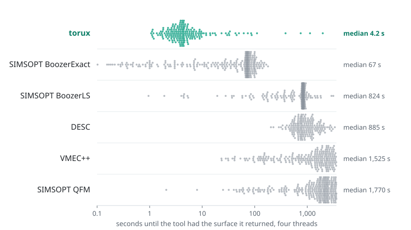
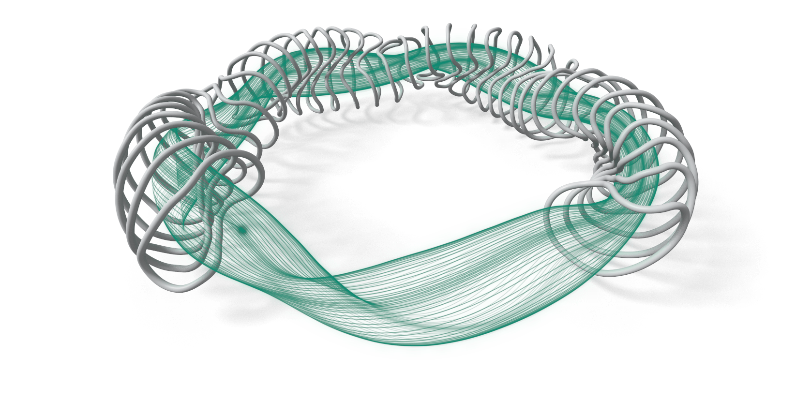
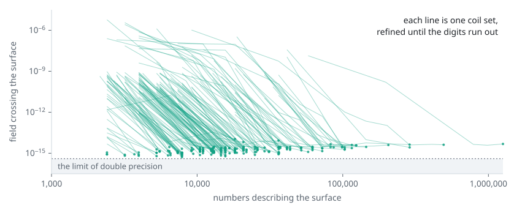
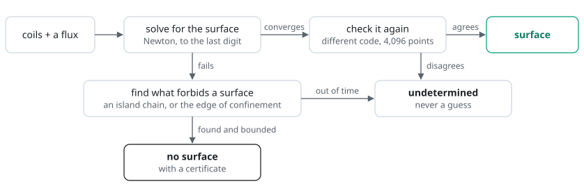
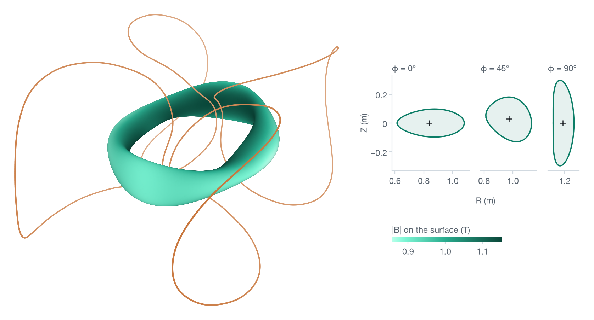

<p align="center">
  <picture>
    <source media="(prefers-color-scheme: dark)" srcset="visuals/torux-dark.png">
    
  </picture>
</p>

<p align="center">
  <picture>
    <source media="(prefers-color-scheme: dark)" srcset="visuals/any-coil-dark.png">
    
  </picture>
</p>

<h1 align="center">Arithmetic limit, extremely fast. Any coil works.</h1>

<p align="center"><sub>(The aspiration. torux is in development, and vacuum only for now: no finite pressure.)</sub></p>

**Give torux the coils of a stellarator. Three seconds later you have the magnetic surface they make, right to the fifteenth digit: the last one a computer holds.**

It has done that for 231,878 of the 371,701 coil sets in [QUASR](https://quasr.flatironinstitute.org), a public database of stellarator designs, in a median of three seconds each. A second evaluator, sharing no code with the solver, checked every one. For 5,206 more it returned a certificate that the surface asked for cannot exist, and for another 846 a weaker one. It never guesses: the other 133,771 it calls undetermined, three in four of them after less than a minute's work.

Above: twelve kinds of magnet, one solver. Nine carry the surface torux verified for them, drawn as light. The other three (a tokamak's poloidal coils, its perturbation coils, a levitated dipole) carry none, and that is an answer too: their field lines, the thin grey ones, close round the coils and never go round the machine, so no surface can enclose toroidal flux, and torux proves it. (A tokamak's surfaces need the current in its plasma, and a dipole holds its plasma on the closed lines themselves.) [Each one, close up.](visuals/README.md)

## Fifteen digits

<picture>
  <source media="(prefers-color-scheme: dark)" srcset="visuals/accuracy-dark.svg">
  
</picture>

Three hundred coil sets drawn at random from QUASR. Every tool gets the same coils, the same requested flux and an hour on four threads for each. The other five need settings, and we chose them: the route each tool's documentation recommends, pushed wherever that paid on six coil sets outside the 300. torux has no settings to choose. One judge: an evaluator that shares no code with any of them, working in extended precision at 4,000 random points of each surface. A dot is a coil set. Its place is how much of the field leaks through the surface. [How each tool was run, and how to run a row again.](results/compare300/README.md)

torux's surfaces leak 1.1 × 10⁻¹⁵, within 2.9 times the least that a surface written in double precision can leak. The worst of its 201 leaks 6.8 × 10⁻¹⁵. On the 199 coil sets both solved, the closest tool, SIMSOPT BoozerExact, leaks 700,000 times more: 5 orders of magnitude. The surfaces the designs are stored with, where every solve starts, leak 8.9 × 10⁻⁴: they are coarse, a few hundred Fourier terms each, where torux's take thousands. [Every dot is a row of `results/compare300.csv`.](results/compare300.csv)

| | surfaces returned | median leak | within 10⁻¹² | median seconds |
|---|---:|---:|---:|---:|
| **torux** | 201 of 300 | 1.1 × 10⁻¹⁵ | 201 | 4.2 |
| SIMSOPT BoozerLS | 283 of 300 | 2.4 × 10⁻⁸ | 38 | 824 |
| SIMSOPT BoozerExact | 288 of 300 | 2.7 × 10⁻⁸ | 51 | 67 |
| SIMSOPT QFM | 297 of 300 | 3.3 × 10⁻⁷ | 14 | 1,770 |
| VMEC++ | 252 of 300 | 9.4 × 10⁻⁴ | 0 | 1,525 |
| DESC | 199 of 300 | 2.6 × 10⁻³ | 0 | 885 |
| QUASR's stored surface | 300 of 300 | 8.9 × 10⁻⁴ | 0 | |

Nobody needs fifteen digits of a flux surface. What you need is never to wonder whether the surface is wrong or the solver. And at this precision "there is no surface" stops being a solve that failed and becomes an answer torux can certify: 22 of these 300, and 16 more by its weaker kind of certificate. The other 61 were still undetermined after their hour.

## Seconds

<picture>
  <source media="(prefers-color-scheme: dark)" srcset="visuals/time-dark.svg">
  
</picture>

The same 300 coil sets on one processor (AMD EPYC 7742), four threads each. A dot is a surface a tool returned, placed at the time at which the tool had it, the tool's own checks included. torux: 4.2 s in the median, and then it stops. The others were set to spend their hour on accuracy and go on working after the surface they return, VMEC++ and SIMSOPT QFM nearly always until the hour ends: that later time is not counted here.

- SIMSOPT BoozerExact: 67 s. On the 199 coil sets both solved it was faster on 12 and more accurate on 0.
- SIMSOPT BoozerLS: 824 s. On the 199 coil sets both solved it was faster on 2 and more accurate on 0.
- DESC: 885 s. On the 141 coil sets both solved it was faster on 0 and more accurate on 0.
- VMEC++: 1,525 s. On the 177 coil sets both solved it was faster on 1 and more accurate on 0.
- SIMSOPT QFM: 1,770 s. On the 199 coil sets both solved it was faster on 0 and more accurate on 0.

## How it works

A stellarator is a fusion machine. Coils wind a magnetic field into a twisted ring, and the field holds a plasma hotter than the centre of the Sun. Follow one line of that field and it goes round and round the ring. If it never leaves one closed surface, that surface is a wall that holds the plasma in. Whether a set of coils makes such walls, and exactly where, is the first question of every design.

<p align="center">
  <picture>
    <source media="(prefers-color-scheme: dark)" srcset="visuals/one-line-dark.gif">
    
  </picture>
</p>

<p align="center"><sub>One field line of Wendelstein 7-X, followed for 200 laps (7.3 km): it never strays more than 1.1 × 10⁻¹³ m from the surface torux computed. <a href="visuals/README.md#one-field-line">How that was measured.</a></sub></p>

torux does not follow the line. It writes the surface as a sum of smooth waves and asks one thing of it: that the field crosses it nowhere. Newton's method finds the waves. Each refinement takes orders of magnitude off the error, until the digits of a 64-bit number run out:

<picture>
  <source media="(prefers-color-scheme: dark)" srcset="visuals/refinement-dark.svg">
  
</picture>

Then a second program, written apart from the first and sharing none of its code, measures the leak at 4,096 random points. Only if both agree is the answer "surface".

<picture>
  <source media="(prefers-color-scheme: dark)" srcset="visuals/answers-dark.svg">
  
</picture>

When Newton fails, the surface may not be there. Near a resonance the field lines close on themselves and the surfaces break into a chain of islands. Past the edge of confinement the lines wander off and are lost. torux finds the chain or the edge, fences it with curves that no surface can cross, and bounds the flux they forbid: a certificate. That is a theorem with a measured error budget, not a machine-checked proof. Of QUASR's certificates, the 5,206 island bands rest on an exact symmetry of the field, and the 846 weaker ones are edge barriers, which rest on a weaker error model. With neither a surface nor a certificate inside its time budget, torux says so.

[The method, for people who know the field.](docs/method.md) [What is checked, and by what.](docs/verification.md)

## Use it

```sh
pip install torux
torux solve quasr:954
```

```
surface                verified: the solver's check and an independent evaluator agree
toroidal flux          0.069106905814 Wb
rotational transform   -0.0975229741144
radii                  major 0.999994679 m, minor 0.150000523 m, aspect ratio 6.66661
volume                 0.444132929 m^3
Fourier series         M, N = 48, 32, with 2 field periods
field across it        1.1e-15 of |B| (the solver's own check)
independent check      3.3e-15 of |B| across it, and the same flux to within 8e-16
time                   0.7 s
```

The first run compiles for up to a minute. After that, seconds.

```python
import torux

s = torux.solve("coils.json", minor_radius=0.15)   # or flux=0.07 (Wb), volume=0.44 (m³), largest=True
print(s)                                 # what it found and how it was checked, or why there is no surface
s.iota, s.volume, s.aspect_ratio         # the numbers
s.save("input.mine")                     # a VMEC input: VMEC, VMEC++, DESC and SIMSOPT read it
s.plot("mine.png")                       # the picture below
s.boozer().quasisymmetry                 # |B| in Boozer angles, and how far it is from quasi-symmetry

torux.check("coils.json", "wout_other.nc")    # a surface from another code: how much of the field crosses it
torux.many(files, table="answers.csv")        # a folder of designs, one row each
```

<p align="center">
  <picture>
    <source media="(prefers-color-scheme: dark)" srcset="visuals/plot-dark.png">
    
  </picture>
</p>

Nothing to tune: no resolution, no tolerance, no starting guess. The coils are a file (SIMSOPT and QUASR JSON, MAKEGRID, FOCUS, permanent magnets, wireframes, a tokamak's coils), a QUASR design by its number, or a SIMSOPT or DESC object you already hold. [Usage](docs/usage.md) and [formats](docs/formats.md).

## Credit

Used torux? Say so, so the next person finds it:

> Flux surfaces computed with [torux](https://github.com/philippbogdan/torux).

```bibtex
@software{bogdan2026torux,
  author = {Bogdan, Philipp},
  title  = {torux: vacuum flux surfaces at the limit of double-precision arithmetic},
  year   = {2026},
  url    = {https://github.com/philippbogdan/torux}
}
```

Public domain, [CC0 1.0](LICENSE), all but the picture of the twelve machines: six of them are drawn from files under GPL, LGPL and CC BY licences, and those renderings stay under their sources' terms. The coil sets torux was run on are other people's work, under their own licences: [credits](NOTICE.md).
