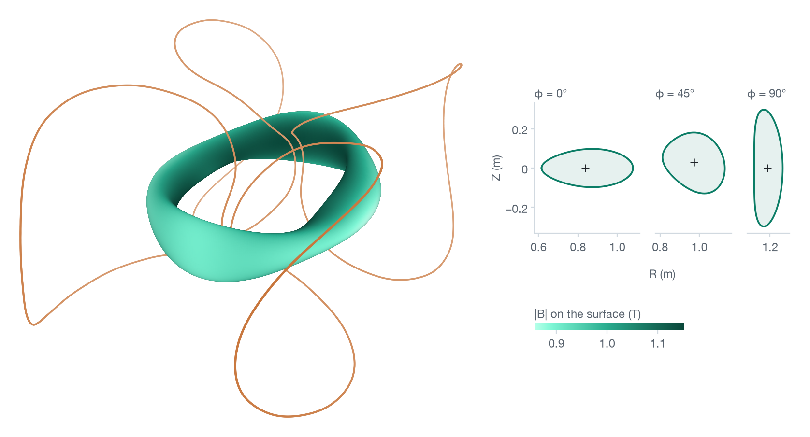

# Usage

```sh
pip install torux      # Python 3.12 or later. "torux[plot]" adds the picture, "torux[hdf5]" the .h5 formats, "torux[all]" both
conda install -c conda-forge torux    # or from conda-forge
git clone https://github.com/philippbogdan/torux && cd torux    # only for the example files used below
uvx torux solve quasr:954    # or with nothing installed, if you have uv: one QUASR design, solved and checked
```

Two verbs and one answer: `solve` finds the flux surface of a coil set, `check` measures a surface another code gave you. There is nothing to tune: no resolution, no tolerance, no starting guess.

## Solving for a flux surface

```sh
torux solve examples/quasr_0000954.json
```

```
surface                verified: the solver's check and an independent evaluator agree
toroidal flux          0.069106905814 Wb
rotational transform   -0.0975229741144
radii                  major 0.999994679 m, minor 0.150000523 m, aspect ratio 6.66661
volume                 0.444132929 m^3
Fourier series         M, N = 48, 32, with 2 field periods
field across it        1.1e-15 of |B| (the solver's own check)
independent check      3.3e-15 of |B| across it, and the same flux to within 8e-16
time                   0.7 s
```

The source is a coil file ([formats](formats.md)), a QUASR design by its number (`torux solve quasr:954` downloads it once and keeps it), or a SIMSOPT `BiotSavart` or DESC `CoilSet` you already hold in Python. The first solve on a machine compiles for up to a minute. After that, seconds.

```python
import torux

s = torux.solve("examples/quasr_0000954.json", minor_radius=0.12)
print(s)
```

```
surface                verified: the solver's check and an independent evaluator agree
asked                  the surface of minor radius 0.12 m
reached                minor radius 0.12 m, within 2.2e-15 of it, solved at that flux (request 4, with a budget of
                       307 s), not scaled or interpolated
toroidal flux          0.0443729923897 Wb
rotational transform   -0.0993649583203
radii                  major 0.997640664 m, minor 0.12 m, aspect ratio 8.31367
volume                 0.283573978 m^3
Fourier series         M, N = 48, 32, with 2 field periods
field across it        1.2e-15 of |B| (the solver's own check)
independent check      2.1e-15 of |B| across it, and the same flux to within 8e-16
requests               4, 1 s in all (answer.evidence['search']['requests'])
budget                 920 s, stated from the source's size since none was given
time                   1.4 s
```

Which surface you want is said in one of four ways:

| | |
|---|---|
| `flux=0.07` | the surface that encloses 0.07 Wb of toroidal flux |
| `minor_radius=0.12` | the surface of that minor radius, in metres |
| `volume=0.3` | the surface that encloses that volume, in cubic metres |
| `largest=True` | the largest surface torux can verify for these coils |

With none of them, a source that carries its own request is asked for that (a QUASR download asks for the flux of its outermost stored surface), and any other source is asked for its largest surface. A size is reached by solving at fluxes until the surface has it: no surface is ever scaled or interpolated.

## The result: status and quantities

`print(s)` says what was found and how it was checked, or why there is no surface. `s.status` is one word:

| `s.status` | |
|---|---|
| `surface` | the surface exists: the solver's check and an evaluator that shares no code with it agree |
| `no_surface` | a certificate that no surface encloses the flux asked for, or for a tokamak's coils or a dipole a proof that there is none at any flux |
| `undetermined` | neither, within the budget |
| `timeout` | neither, and the last step ended past the budget |
| `surface_unverified` | a torus was found and the independent check did not confirm it: not an answer |
| `no_axis` | no magnetic axis was found |
| `error` | something broke, and the answer says what |

```python
s.iota, s.flux                                   # rotational transform, and toroidal flux in Wb
s.volume, s.area                                 # m³, m²
s.major_radius, s.minor_radius, s.aspect_ratio   # m, by VMEC's and SIMSOPT's definitions
R, Z = s.section(phi=0.0)                        # the cross-section at a cylindrical angle
x = s.points(theta, phi)                         # Cartesian points at theta, the straight-field-line angle, and phi, the cylindrical angle
B = s.field(x)                                   # the coils' field there, T
s.profile                                        # flux and rotational transform of the surfaces the solve followed
s.surface.rc, s.surface.zs                       # R = Σ rc[m, n+N] cos(mθ − n·nfp·φ), Z = Σ zs[m, n+N] sin(mθ − n·nfp·φ)
s.evidence                                       # both checks in full, or the certificate, or the proof
```

Without a verified surface the numbers, the section and the points raise a `ValueError` naming the status. `profile`, `field` and `evidence` are there whatever the answer. `theta` and `phi` may be arrays of any one shape, and the points keep it. θ runs counter-clockwise in the (R, Z) plane, so ι has the sign VMEC gives it: the opposite of the sign QUASR quotes for the same coils.

## The outermost flux surface

```sh
torux solve examples/hsx.json --budget 900
```

```
surface                verified: the solver's check and an independent evaluator agree
asked                  the largest surface torux can verify
reached                0.0427335389 Wb, solved at that flux (request 4, with a budget of 379 s), not scaled or
                       interpolated
toroidal flux          0.0427335389056 Wb
rotational transform   1.10455336999
radii                  major 1.21176129 m, minor 0.126615413 m, aspect ratio 9.57041
volume                 0.383459913 m^3
Fourier series         M, N = 640, 224, with 4 field periods
field across it        4.6e-15 of |B| (the solver's own check)
independent check      1.4e-14 of |B| across it, and the same flux to within 2e-15
beyond it              at 0.0641003084 Wb torux could not decide within 155 s (neither a surface nor a certificate
                       within the budget)
then                   at 0.0854670778 Wb torux could not decide within 379 s (neither a surface nor a certificate
                       within the budget)
so                     no certified bound on what the coils hold within the budget
requests               6, 891 s in all (answer.evidence['search']['requests'])
budget                 900 s, as given
time                   891 s
```

The largest surface is searched for by requests at fluxes: first the family of surfaces from the magnetic axis outward, then direct requests at the fluxes that family reached, one far beyond them all for a certificate, and then between the last verified flux and the first that failed. The answer is the largest surface verified, with what stands beyond it: a certified bound, so that the coils hold at least this and at most that, or else the flux at which torux could not decide in the time it had. A larger budget can find more: without one torux states a budget from the size of the source, half an hour or more. The command line says each request as it ends (`range` is the family from the axis, with the outermost surface verified in it). In Python the call is silent, and the same lines go to the logger `torux`: `logging.basicConfig(level=logging.INFO)` shows them.

## No-surface certificates: islands and the last surface

```python
print(torux.solve("examples/quasr_1100073.json", budget_s=3300))
```

```
no surface             certified: the flux asked for lies beyond the last surface these coils make
requested flux         0.06949574 Wb
upper bound            0.0611262057 Wb: no surface encloses more (the largest may enclose less: ask largest=True)
rests on               curves no surface crosses, from an X line of period 11, with some error terms strict bounds and
                       some validated models: the weakest kind of certificate torux gives
time                   64.0 s
```

```python
print(torux.solve("examples/quasr_0219457.json", budget_s=3300))
```

```
no surface             certified: an island chain fills the flux asked for
requested flux         0.00691967279 Wb
none between           0.00691720393 and 0.00692209431 Wb
island chain           at iota = -1/5, 15 islands in each cross-section
rests on               an exact theorem (stellarator symmetry) and curves traced with a measured error budget, not
                       interval arithmetic
time                   101 s
```

A certificate takes minutes and needs room: give `budget_s=3300` when you expect one. The call returns as soon as it has its answer. The bound of the first is not the largest surface: `largest=True` looks for that. And a certificate is not promised: the last section has a request a hair beyond this one that got none. Without a surface or a certificate the answer is `undetermined`, and says what it found, what it tried and what to do next. The first request again, with five seconds:

```python
print(torux.solve("examples/quasr_1100073.json", budget_s=5))
```

```
undetermined           neither a surface nor a certificate within the 5 s budget
requested flux         0.06949574 Wb
found                  the magnetic axis (iota -0.447709), surfaces out to 0.00837087 Wb (the solver's check only)
tried                  Newton from the file's own surface (it did not converge)
next                   a certificate needs minutes: run again with budget_s=3300
time                   4.9 s
```

With a budget this short the first word is sometimes `timeout`: the last step ended a tenth of a second past it.

## Checking a surface from another code

```python
c = torux.check("examples/quasr_0000954.json", "examples/quasr_0000954.json")   # the coils, then a surface: here the one QUASR stores with them
print(c)
c.leak, c.flux
print(torux.check("examples/quasr_0000954.json", torux.solve("examples/quasr_0000954.json")))   # torux's own, at the same flux
```

```
surface                quasr_0000954.json: SurfaceXYZTensorFourier30, the outermost of 3, M, N = 10, 10
field periods          2
field across it        9.4e-06 of |B| at worst, 1.8e-06 in the median, at 4,096 points (the evaluator's rounding: 3e-17)
toroidal flux          0.0691067715622 Wb, the mean through 6 cross-sections, which differ by 3.3e-06 of it
```

```
surface                a torux answer (surface): torux's Fourier series, M, N = 48, 32
field periods          2
field across it        1.8e-15 of |B| at worst, 1.3e-16 in the median, at 4,096 points (the evaluator's rounding: 9e-18)
toroidal flux          0.069106905814 Wb, the mean through 6 cross-sections, which differ by 6.0e-16 of it
stated flux            0.069106905814 Wb (the answer's), and the flux inside is larger by 2.2e-16 of it
```

The first row of numbers is the leak: the largest |B·n|/|B| at 4,096 random points of the surface, which is zero on an exact flux surface, with the evaluator's own rounding at that point for scale. The independent check of a solve reads a little more on the same surface, 3.3 × 10⁻¹⁵ here: it climbs from its worst point to the local maximum. The second is the toroidal flux through six cross-sections: on a flux surface they agree, so their spread is a second sign of a leak.

`check` takes the coils and a surface and measures, with the independent evaluator alone, how much of the field crosses the surface and how much flux it encloses. It pronounces no verdict. The surface is a VMEC or VMEC++ `wout` file, a VMEC input file, a SIMSOPT or QUASR JSON file, a saved torux answer, or a live object: a SIMSOPT `SurfaceRZFourier` or `SurfaceXYZTensorFourier`, a DESC `FourierRZToroidalSurface` or `Equilibrium`, a VMEC++ output, a torux answer ([formats](formats.md)). From the shell: `torux check coils.json wout_mine.nc`.

A SIMSOPT `BoozerSurface` or `QfmSurface`, in a file or live, names the coils it was computed for, and `check` compares the source's field on its surface with theirs. Where they differ by less than a tenth of the leak measured, the difference cannot account for the leak: `check` measures, and says by how much they differ (`c.coils_differ`). Where they differ by a tenth of it or more, it refuses, unless asked with `mismatched_coils=True` (`--mismatched-coils`), and then the result still says by how much. Where a `Current` of the surface's own coils states two values, `surface_currents=` (`--surface-currents`) says which they carried ([formats](formats.md#a-surface-and-the-coils-it-was-computed-for)). A file holding several coil sets needs `which=` in `torux.load`, or `--coils` on the command line, and the error names the set each `BoozerSurface` or `QfmSurface` of the file was computed with.

## Export: VMEC input, JSON, VTK

```python
s = torux.solve("examples/quasr_0000954.json")
s.save("input.q954")                      # a VMEC input file with every coefficient: VMEC, VMEC++, DESC and SIMSOPT read it
s.save("input.q954_cut", mpol=9, ntor=8)  # cut to MPOL = 9, NTOR = 8: returns how far the cut moved the surface, in m
s.save("q954.json")                       # the whole answer: torux.Answer.read("q954.json") reads it back
s.save("q954.vtk")                        # the surface with |B|, for ParaView
print(torux.check("examples/quasr_0000954.json", "input.q954_cut"))   # what the cut cost
```

```
surface                input.q954_cut: VMEC input boundary, M, N = 8, 8
field periods          2
field across it        1.6e-05 of |B| at worst, 4.0e-06 in the median, at 4,096 points (the evaluator's rounding: 1e-17)
toroidal flux          0.0691069092099 Wb, the mean through 6 cross-sections, which differ by 1.0e-05 of it
stated flux            0.069106905814 Wb (the file's PHIEDGE), and the flux inside is larger by 4.9e-08 of it
```

The file is exact unless you cut it, and a cut file says in its first line how far any point moved. `mpol` and `ntor` are VMEC's own numbers: `mpol=9` writes `MPOL = 9`, the modes m = 0 to 8, and `ntor=8` writes `NTOR = 8`, the modes |n| ≤ 8. From the shell: `torux solve examples/quasr_0000954.json --save input.q954_cut --mpol 9 --ntor 8`. For scale, the surfaces VMEC++ finds for itself from coils like these leak a median 9.4 × 10⁻⁴ of |B| (the README's table), sixty times more than this cut. An answer read back from its JSON prints, gives its numbers and points and writes its files again. Its field, its picture and its Boozer spectrum need the coils: for those, solve again.

There is no object for another code in an answer: the file is the route, and the other codes read it with their own calls: `SurfaceRZFourier.from_vmec_input("input.q954")` in SIMSOPT, `vmecpp.VmecInput.from_file("input.q954")` in VMEC++, `FourierRZToroidalSurface.from_input_file("input.q954")` in DESC. SIMSOPT reads the whole file to 6 × 10⁻¹⁵ m and VMEC++ to 1 × 10⁻¹⁵ m. DESC's reader of VMEC inputs keeps eight decimals, 9 × 10⁻¹⁰ m here, and turns the poloidal angle round. VMEC++ 0.9.3 run on the cut file above converges to an edge rotational transform of -0.09757 where torux has -0.09752.

## Plotting

```python
s.plot("q954.png")          # .png, .pdf or .svg, and dark=True for a dark page
```

<picture>
  <source media="(prefers-color-scheme: dark)" srcset="../visuals/plot-dark.png">
  
</picture>

The surface coloured by field strength inside its coils, and three cross-sections. Green is a surface the independent check verified and nothing else: any other torus an answer holds (`surface_unverified`, `range_unverified`, `verify=False`, a timeout) is drawn in greys, its sections dashed. Coils without current, conductors of finite section and the 1/R field are not drawn, and a warning names them.

## Boozer spectrum and quasisymmetry

```python
b = s.boozer()
print(b)
b.quasisymmetry, b.helicity, b.modes
```

```
mean field             1.011727226 T
quasi-symmetry         1.8038e-04 for quasi-axisymmetric: SIMSOPT's NonQuasiSymmetricRatio (QUASR's f_QS)
next closest           7.2391e-03 for quasi-helical, n = -1
largest B_mn / B_00    (1, +0) -1.1567e-01  (0, +2) -1.1331e-02  (2, +1) -1.0245e-02
                       (2, -1) -9.8054e-03  (2, +0) +6.7935e-03  (0, +4) -6.5143e-03
harmonics              3153 (m <= 48, |n| <= 32), each within 2e-14 T
convention             cos(m theta_B - n nfp zeta_B), nfp = 2: booz_xform's xm_b = m, xn_b = n nfp
time                   0.3 s
```

|B| on the surface in Boozer angles, harmonic by harmonic, and how far it is from quasi-symmetry, by the measure SIMSOPT optimises and QUASR reports.

## Gradients

```python
g = torux.solve("examples/quasr_0000954.json", gradients=True).gradients
g["d_iota_d_current"]     # dι/dI, per ampere: one number a coil, in the order of the file, a coil of zero current included
g["d_iota_d_coef"]        # dι/d(coefficient), per metre: per coil, per Cartesian component, per Fourier coefficient
g["d_iota_d_flux"]        # dι/dΨ, per weber
```

The derivative of ι in every parameter of the source and in the flux, by the adjoint method. They are saved with the answer's JSON.

Each coil's numbers are what changing that coil alone does, its copies left as they are, with field periods, stellarator symmetry or neither. A symmetric source is solved on one period, whose derivatives are exact for every change that keeps the symmetry, and since ι is unchanged by the symmetry the derivative in one coil is their average over the symmetry group. For QUASR 954 the first coil's dι/dI is 9.833739 × 10⁻¹⁰ per ampere, and solving again with only that coil's current changed by ±0.01%, no symmetry assumed, gives 9.833740 × 10⁻¹⁰. For QUASR 219457 with its coils of negative current at 3% more, three field periods and no stellarator symmetry, it is -3.636033 × 10⁻⁸. Solving again the same way gives -3.636130 × 10⁻⁸, and -3.645812 × 10⁻⁸ at ±0.1%: the central difference's own error, a hundred times larger for a step ten times larger, and with that error extrapolated away, -3.636032 × 10⁻⁸. The copies are found by matching every coil, turned by the symmetry, against the source's own, up to where its parameter starts and which way it runs (polygon loops, segments, dipoles and rings the same way). Where a copy is not found so, `parts`, `d_iota_d_coef` and `d_iota_d_current` are not given at the top: `g["per_coil"]` says why, and `g["one_period"]` holds the one-period solve's numbers under those three names, which mean something only summed over a coil's copies. dι/dΨ is the same either way, and so are `system` and `vjp` below, which are the one-period solve's own.

A coil of zero current makes no field, and its numbers are still there: zero in its coefficients, and in its current the derivative of ι as that coil's field grows from nothing. A zero-current copy of a coil has that coil's dι/dI.

Without stellarator symmetry they come from the adjoint of `system_general` (the next section) on the surface torux found. For QUASR 954 with the mirrored copy of its coil at 3% more current, asked for 0.05 Wb, at M, N = 32, 32, that adds 5.5 s to the solve (an M4 Mac mini, four threads). Its Jacobian is 571 MB, built after the solve's own peak in memory has passed.

## The equations at any surface

```python
F, J = s.system(rc, zs, iota)      # torux's equations at a surface of any resolution, and their Jacobian
d = s.vjp(rc, zs, iota, lam)       # λᵀ ∂F/∂(coils, flux)
```

The two pieces an adjoint needs, as SIMSOPT's `BoozerSurface` objectives use them: the Jacobian, to solve Jᵀλ = ∂f/∂u, and the product in the coils. On a solution the derivative of f in the coils is then minus that product.

`rc` and `zs` (M+1, 2N+1) are a stellarator-symmetric surface at any M ≥ 1, N ≥ 0, in the series of `s.surface`, and `iota` its rotational transform. The unknowns u are a stellarator-symmetric `SurfaceRZFourier`'s dofs in SIMSOPT's order, then ι: 2M(2N+1) + 2N + 2 of them. F holds the sine projections of R_φ + ι R_θ − R B_R/B_φ, indexed like zs, the cosine projections of Z_φ + ι Z_θ − R B_Z/B_φ, indexed like rc, and the flux row (Ψ(u) − Ψ₀) rc[0, N]/|Ψ₀|, Ψ₀ = `s.surface.flux`. On the surface torux found F = 0 to rounding. J = ∂F/∂u is the Jacobian of torux's own Newton method. Its flux row holds rc[0, N]/|Ψ₀| fixed, which matters only off a solution, and differentiates the flux as the integral of B_φ over the cross-section, which F's quadrature follows to 4 × 10⁻⁶ of the row at M = 5, N = 4 and closer than finite differences resolve at M = 12, N = 10.

`d["coef"]` (ncoil, 3, 2K+1), in `CurveXYZFourier`'s order, and `d["current"]` are the coils in the order of the source, for a `BiotSavart` that of `bs.coils`. `d["d_coef"]`, `d["d_current"]` and `d["d_flux"]` are λᵀ∂F/∂coef, λᵀ∂F/∂I and λᵀ∂F/∂Ψ₀. A coil of zero current is kept, with its true derivatives: zero in its coefficients, as its field is, and the derivative of F in its current. Both calls need the source and a surface, so an answer read from a file or settled by proof raises a `ValueError`, and `vjp` takes Fourier coils alone.

F is the equations on one field period. So for a source with field periods or stellarator symmetry, the product in one coil is that coil's part of a change made to all its copies, unlike the gradients above, which are averaged over the symmetry: exact where the copies share their dofs, as SIMSOPT's `coils_via_symmetries` makes them, and not the effect of one coil whose dofs are its own.

Without stellarator symmetry:

```python
F, J = s.system_general(rc, rs, zc, zs, iota)   # a surface without stellarator symmetry, and the Jacobian
d = s.vjp_general(rc, rs, zc, zs, iota, lam)    # λᵀ ∂F/∂(coils, flux)
```

`rc`, `rs`, `zc` and `zs` (M+1, 2N+1) are a surface in the series of a `SurfaceRZFourier`, R = Σ rc[m, n+N] cos(mθ − n·nfp·φ) + rs[m, n+N] sin(mθ − n·nfp·φ) and Z the same with zc and zs, φ the cylindrical angle. The unknowns u are its dofs without stellarator symmetry in SIMSOPT's order, then ι: 2(2M+1)(2N+1) + 1 of them, which SIMSOPT's adjoint takes as it takes the symmetric ones. `s` may hold a stellarator-symmetric surface or not.

Without the symmetry two things are free that it fixes: the origin of θ, and one equation, which the others imply up to the truncation because the flux of B out of any closed surface is zero. torux's solver carries a multiplier for that equation as one more unknown, and here it is solved for. F holds the projections G of R_φ + ι R_θ − R B_R/B_φ and of Z_φ + ι Z_θ − R B_Z/B_φ on cos and sin(mθ − n·nfp·φ), indexed like rc, rs, zc and zs in u, each less its share of the pivot's: G − (Pν/Pν[p]) G[p], where Pν are the projections of ν = (−Z_θ, R_θ)/(R_θ² + Z_θ²) on a reference surface and p is the entry of the largest |Pν|. These vanish exactly where G is a multiple of Pν. That is the solver's own direction without its 1/B_φ, so the two have the same surface up to the truncation: ι to 10⁻¹³ at M = 8, N = 6 and to rounding from M = 12, N = 10. In the pivot's place, which they leave zero on any surface, F holds the phase condition ⟨X − X_ref, ∂X_ref/∂θ⟩/|∂X_ref/∂θ| = 0, and last the flux row of `system`. The reference is `s.surface` cut or padded to M, N. J = ∂F/∂u, with the flux row of `system`, and `d` is what `vjp` gives, for this F.

For QUASR 954 with the mirrored copy of its coil at 3% more current, asked for 0.05 Wb, F is 6 × 10⁻¹⁶ on the surface torux finds, M, N = 32, 32. J matches central differences to 4 × 10⁻¹² of its largest entry in all 199 columns at M = 5, N = 4, its flux row to 8 × 10⁻⁷ of the row, and `d` matches them to 5 × 10⁻⁹ in the currents, the coefficients and the flux. At those 8,451 unknowns `system_general` takes 0.7 s and the 571 MB of J, and `vjp_general` 1.0 s and 30 MB, on an M4 Mac mini with four threads.

## Batch runs

```sh
torux many designs/*.json --table answers.csv --save answers/
```

```
torux: 3 designs to solve, 2 at a time: each is a line below when it ends
surface       designs/quasr_0000954.json   0.7 s
no_surface    designs/quasr_1100073.json   81.9 s
no_surface    designs/quasr_0219457.json   99.1 s
2 no surface  1 surface
```

Each design is solved in a process of its own, as many at once as the machine has cores for. The table gets one row a design as it finishes: the design's name, the [columns](../results/README.md) of `results/quasr.parquet`, then the surface's minor radius and volume. Run the same command again and it carries on where it stopped: a design with a row is not solved again, unless its row says `error`. A design is known by its file, however you spell the path from the folder you run in. A table holds the answers to one question, the last column says which, and `many` refuses to continue it with another. `note` says what an outcome's word does not, and for a size the coils were not shown to hold, that `flux_Wb` is the flux the size would need. `--save` keeps every answer as JSON. `many` asks every design the question `solve` would: `--flux`, `--minor-radius`, `--volume` or `--largest`, or each design's own. Each design gets the budget torux states for it, five minutes or so: `--budget 3300` gives each the room a certificate can need. In Python: `answers = torux.many(files, table="answers.csv", save="answers/")`, the answers in the order given. `--coils` and `--currents`, `which=` and `currents=` in Python, are `torux.load`'s for every design. On a later run a design already in the table comes back as the answer saved for it, or as `None` where none was saved.

## Coil and magnet sources

```python
torux.solve("examples/hsx.json", flux=0.0359)      # a file: the format is read from the file itself
torux.solve("quasr:954")                           # a QUASR design by its number: downloaded once, then kept

from simsopt import load
from simsopt.field import BiotSavart
surfaces, coils = load("examples/quasr_0000954.json")    # SIMSOPT's own reading of a QUASR file: its surfaces, its coils
torux.solve(BiotSavart(coils), flux=0.05)          # a SIMSOPT BiotSavart, a Coil or a list of Coils, as you hold them
torux.check(coils, surfaces[-1])                   # and a SIMSOPT surface against them
```

A SIMSOPT object is read with the current each `Current` holds, `get_value()`, the one SIMSOPT computes its field with. A DESC `CoilSet`, `MixedCoilSet` or single coil is given the same way. SIMSOPT's own field of QUASR's coils, at the 160 quadrature points their files carry, differs from torux's by 1.5 × 10⁻¹², the error of its trapezoid rule, and by 2.8 × 10⁻¹⁵ at 4,096 points: a torux surface tested with SIMSOPT's `BiotSavart` needs the finer rule to show what it is. Several files whose parts add up are one source: `torux.load(coils_file, magnets_file, nfp=2)`.

A source can also be built in code:

```python
coils = torux.FourierCurves(coef, current)     # coef[i, a, :] = [c0, s1, c1, ..., sK, cK] of coil i, Cartesian component a, and the currents in amperes
src = torux.Source(id="mine", parts=[coils], nfp=2, stellsym=True)
s = torux.solve(src, flux=0.05)
```

Parts: `FourierCurves`, `PolylineCurves`, `Segments`, `Dipoles`, `Rings`, `AxisymPolygons`, `ToroidalField`. Units are SI throughout: metres, amperes, A m², tesla, webers. A symmetry you claim (`nfp`, `stellsym`) is yours to guarantee, and the loaders verify it on the parts before using it. torux takes μ₀ = 4π × 10⁻⁷ H/m, as SIMSOPT and VMEC do. DESC takes CODATA's value, so the same coils' field is 1.3 parts in 10¹⁰ larger here than in DESC.

## Command line

```text
torux solve SOURCE [SOURCE ...] [--flux WB | --minor-radius M | --volume M3 | --largest] [--budget S] [--nfp N]
            [--kind stellarator|tokamak|dipole] [--gradients] [--no-verify] [--trace-lines N]
            [--save FILE] [--mpol N] [--ntor N] [--plot FILE] [--boozer] [--coils NAME] [--currents saved|dofs]
torux check SOURCE [SOURCE ...] SURFACE [--flux WB] [--nfp N] [--which NAME] [--coils NAME] [--currents saved|dofs]
            [--surface-currents saved|dofs] [--mismatched-coils]
torux many SOURCE [SOURCE ...] --table FILE [--flux WB | --minor-radius M | --volume M3 | --largest]
            [--budget S] [--jobs N] [--save DIR] [--coils NAME] [--currents saved|dofs]
```

`--coils` and `--currents` are what `torux.load` takes as `which=` and `currents=` for a SIMSOPT JSON source: the coil set of a file holding several, by its `BiotSavart`'s name or index, and which of a `Current` object's two values to take where they differ ([formats](formats.md#simsopt-files-torux-refuses-rather-than-guess)). In `many` they apply to every design. With several source files, `--coils` once is the first file's, and given once per file, in order, it is each file's, `-` for a file that needs none: `torux check a.json b.json surface.json --coils BiotSavart1 --coils BiotSavart2`, as `which=["BiotSavart1", "BiotSavart2"]` in Python. In `check`, `--which` is the surface's: `torux check file.json file.json --coils BiotSavart6 --which SurfaceXYZTensorFourier3`, and `--surface-currents` and `--mismatched-coils` are its `surface_currents=` and `mismatched_coils=True`.

`solve` prints the answer on standard output and says on standard error what it is asking and, in a search, each request as it ends. It exits with 0 for a surface or a certified or proved no-surface, 2 for anything undetermined and nothing else, 1 for an error, a command line it cannot read included.

## Budget, memory and threads

- `budget_s`: seconds for the whole question (in `many`, for each design's). The call returns within it, up to one last step, and as soon as it has its answer. By default torux states a budget from the size of the source: at least five minutes for a flux, fifteen for a size, half an hour for the largest surface. A surface takes seconds when the file brings a surface to start from, as QUASR's do, seconds to minutes from the coils alone, and a certificate takes minutes.
- Near the edge of what the coils hold, an outcome can depend on the clock: the solver shares its budget among its stages by the time each takes, so the same request can come back undetermined on a slower or busier machine. Asked twice for the surface of `examples/quasr_0000954.json` that encloses 0.41495 Wb, six times its design flux, torux verified it in 198 s and came back `undetermined` after 263 s in the next process. Asked for 0.0695 Wb of `examples/quasr_1100073.json`, a hair more than the file's own 0.06949574 Wb, it gave up after 1,914 s, where the file's own request gets its certificate in 116 s ([`results/edge_requests.csv`](../results/edge_requests.csv)). A surface that is returned is verified either way.
- Memory: about a gigabyte for an ordinary request. A hard one can take several: of the 300 coil sets of the comparison the hardest took 7.5 GiB and the next 4.1.
- `verify=False` skips the independent check: the answer then rests on the solver's own checks and says so, and its picture is in greys.
- `trace_lines=8` also follows eight field lines with the independent tracer for 100 turns round the machine and reports how far they stray from the surface. Minutes.

| variable | effect |
|---|---|
| `TORUX_THREADS` | threads of every pool (default: four, or the cores available if fewer) |
| `TORUX_CACHE_DIR` | where compiled programs and QUASR downloads are kept (default `~/.cache/torux`) |

Importing torux sets every BLAS thread pool in the process to `TORUX_THREADS`, those numpy and scipy had already started included: the last digits of a surface depend on that number, and this way the same request gives the same digits whatever was imported first and however many cores the machine has.
