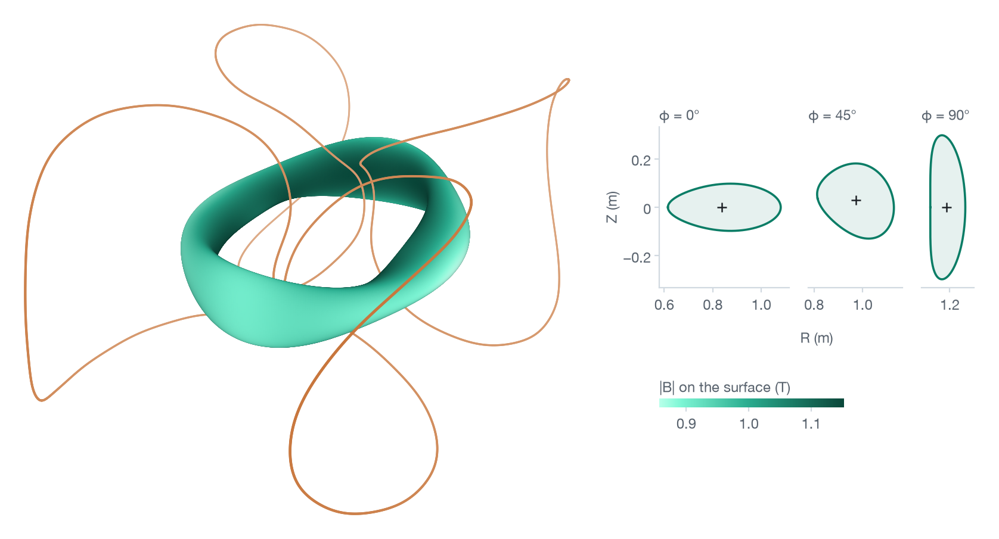

# Usage

```sh
pip install torux      # Python 3.12 or later. "torux[plot]" adds the picture, "torux[hdf5]" the .h5 formats, "torux[all]" both
conda install -c conda-forge torux    # or from conda-forge
git clone https://github.com/philippbogdan/torux && cd torux    # only for the example files used below
uvx torux solve quasr:954    # or with nothing installed, if you have uv: one QUASR design, solved and checked
```

Two verbs and one answer: `solve` finds the flux surface of a coil set, `check` measures a surface another code gave you. There is nothing to tune: torux asks for no resolution, no tolerance and no starting guess.

## Solving for a flux surface

```sh
torux solve examples/quasr_0000954.json
```

```
surface                verified: the solver's check and an independent evaluator agree
toroidal flux          0.069106905814 Wb
rotational transform   -0.0975229741144
radii                  major 0.999994679 m, minor 0.150000523 m, aspect ratio 6.66661
volume                 0.444132929 m^3
Fourier series         M, N = 48, 32, with 2 field periods
field across it        1.1e-15 of |B| (the solver's own check)
independent check      3.3e-15 of |B| across it, and the same flux to within 8e-16
time                   0.7 s
```

The source is a coil file ([formats](formats.md)), a QUASR design by its number (`torux solve quasr:954` downloads it once and keeps it), or a SIMSOPT `BiotSavart` or DESC `CoilSet` you already hold in Python. The first solve on a machine compiles for up to a minute. After that, seconds.

```python
import torux

s = torux.solve("examples/quasr_0000954.json", minor_radius=0.12)
print(s)
```

```
surface                verified: the solver's check and an independent evaluator agree
asked                  the surface of minor radius 0.12 m
reached                minor radius 0.12 m, within 2.2e-15 of it, solved at that flux (request 4, with a budget of
                       307 s), not scaled or interpolated
toroidal flux          0.0443729923897 Wb
rotational transform   -0.0993649583203
radii                  major 0.997640664 m, minor 0.12 m, aspect ratio 8.31367
volume                 0.283573978 m^3
Fourier series         M, N = 48, 32, with 2 field periods
field across it        1.2e-15 of |B| (the solver's own check)
independent check      2.1e-15 of |B| across it, and the same flux to within 8e-16
requests               4, 1 s in all (answer.evidence['search']['requests'])
budget                 920 s, stated from the source's size since none was given
time                   1.4 s
```

Which surface you want is said in one of four ways:

| | |
|---|---|
| `flux=0.07` | the surface that encloses 0.07 Wb of toroidal flux |
| `minor_radius=0.12` | the surface of that minor radius, in metres |
| `volume=0.3` | the surface that encloses that volume, in cubic metres |
| `largest=True` | the largest surface torux can verify for these coils |

With none of them, a source that carries its own request is asked for that (a QUASR download asks for the flux of its outermost stored surface), and any other source is asked for its largest surface. A size is reached by solving at fluxes until the surface has it: no surface is ever scaled or interpolated.

## The result: status and quantities

`print(s)` says what was found and how it was checked, or why there is no surface. `s.status` is one word:

| `s.status` | |
|---|---|
| `surface` | a surface, verified: the solver's check and an evaluator whose field code shares none with it agree |
| `no_surface` | a certificate that no surface encloses the flux asked for, or for a tokamak's coils or a dipole a proof that there is none at any flux |
| `undetermined` | neither, within the budget |
| `timeout` | neither, and the last step ended past the budget |
| `surface_unverified` | a torus was found and did not pass the solver's check or the independent one: not an answer |
| `no_axis` | no magnetic axis was found |
| `error` | something broke, and the answer says what |

```python
s.iota, s.flux                                   # rotational transform, and toroidal flux in Wb
s.volume, s.area                                 # m³, m²
s.major_radius, s.minor_radius, s.aspect_ratio   # m, by VMEC's and SIMSOPT's definitions
R, Z = s.section(phi=0.0)                        # the cross-section at a cylindrical angle
x = s.points(theta, phi)                         # Cartesian points at theta, the straight-field-line angle, and phi, the cylindrical angle
B = s.field(x)                                   # the coils' field there, T
s.profile                                        # flux and rotational transform of the surfaces the solve followed
s.surface.rc, s.surface.zs                       # R = Σ rc[m, n+N] cos(mθ − n·nfp·φ), Z = Σ zs[m, n+N] sin(mθ − n·nfp·φ)
s.evidence                                       # both checks in full, or the certificate, or the proof
```

Without a verified surface the numbers, the section and the points raise a `ValueError` naming the status. `profile`, `field` and `evidence` are there whatever the answer. `theta` and `phi` may be arrays of any one shape, and the points keep it. θ runs counter-clockwise in the (R, Z) plane, so ι has the sign VMEC gives it: the opposite of the sign QUASR quotes for the same coils.

## The outermost flux surface

```sh
torux solve examples/hsx.json --budget 900
```

```
surface                verified: the solver's check and an independent evaluator agree
asked                  the largest surface torux can verify
reached                0.0427335389 Wb, solved at that flux (request 4, with a budget of 379 s), not scaled or
                       interpolated
toroidal flux          0.0427335389056 Wb
rotational transform   1.10455336999
radii                  major 1.21176129 m, minor 0.126615413 m, aspect ratio 9.57041
volume                 0.383459913 m^3
Fourier series         M, N = 640, 224, with 4 field periods
field across it        4.6e-15 of |B| (the solver's own check)
independent check      1.4e-14 of |B| across it, and the same flux to within 2e-15
beyond it              at 0.0641003084 Wb torux could not decide within 155 s (neither a surface nor a certificate
                       within the budget)
then                   at 0.0854670778 Wb torux could not decide within 379 s (neither a surface nor a certificate
                       within the budget)
so                     no certified bound on what the coils hold within the budget
requests               6, 891 s in all (answer.evidence['search']['requests'])
budget                 900 s, as given
time                   891 s
```

The largest surface is searched for by requests at fluxes: first the family of surfaces from the magnetic axis outward, then direct requests at the fluxes that family reached, one far beyond them all for a certificate, and then between the last verified flux and the first that failed. The answer is the largest surface verified, with what stands beyond it: a certified bound, so that the coils hold at least this and at most that, or else the flux at which torux could not decide in the time it had. A larger budget can find more: without one torux states a budget from the size of the source, half an hour or more. The command line says each request as it ends (`range` is the family from the axis, with the outermost surface verified in it). In Python the call is silent, and the same lines go to the logger `torux`: `logging.basicConfig(level=logging.INFO)` shows them.

Every island chain a request identified is in the answer whatever came of the request: `answer.evidence['chains']`, once each for a whole search (with `found_by`, the numbers of the requests that found it) and per request in `answer.evidence['search']['requests'][i]['chains']`. Each gives the chain's p/q and iota, and as far as the request computed them the flux of its resonant surface, its elliptic and hyperbolic closed lines (`O`, `X`: residue and crossings of the plane φ = 0), the pendulum estimate of its half width in flux and the shear that estimate used, and the stage that met it (`family`, `island band`, `edge barrier`). The half width is an estimate from one residue, which is the chain's, and one shear, which is the request's: the slope of ι over the family's last step before the chain. The family's steps scale with the square root of the flux asked for, and ι steepens as the surfaces near the chain, so a request whose family stops nearer the chain gives a steeper slope and a smaller half width. On CNT at 78° and I_IL / I_PF = 3 the same chain's half width runs from 6.2 × 10⁻⁵ to 2.7 × 10⁻⁴ Wb across six requests: take it as an order of magnitude.

The search for the largest surface also lists the chains the answer's family stepped across: every rational p/q with q ≤ 30 that ι passed between two tori of the family from the axis to the answer, where the chain was thin enough for the family to go on (`found_in` `stepped across`, `torux.crossed`). For each, the two family tori either side are refined to the rounding floor and accepted as any verified surface is, the chain's O and X lines are found from the nearer and kept only where every crossing lies between those two tori, and the half width takes its shear from the two tori, which lie on both sides of the chain. This takes the time the search left of its budget, and when that is less than 90 s (or 7.5 % of the budget, if less) that much after the search's end, then as long again to refine the residues of the lines it found (a line it has no time left for is unresolved and counted in `lines_unrefined`), so that the search itself is given just what it would be without it. The answer's budget line says how long it ran past the budget. The chains of lowest q go first, and one the time did not reach says `cut`. On CNT at 64° and I_IL / I_PF = 4.5 the family steps across ι = −1/6, −2/11, −1/5, −4/19, −2/9 and −4/17 on its way to the edge.

Every chain says where its flux comes from and what holds it. `flux_from` is `between family tori` for a stepped-across chain, linear in ι between the two tori either side (`family_Wb`), and `extrapolated` for a chain ahead of where the family stalled: beyond its last torus (`family_Wb`) with the slope of ι over the family's last step, which near a chain or the edge can be far from the slope where the chain is. Where the family stalls, `stalled_at` is true for the chain it stalled at, the rational of q ≤ 30 it meets first beyond its last torus, as the stepped-across chains are listed to q ≤ 30. Where a rational of lower order lies further ahead, the family's jump tries to cross that one, and it is listed with `stalled_at` false: on CNT at 90° and I_IL / I_PF = 4.70 the family stalls at ι = −0.31689 short of −6/19, and the jump tries −4/13 beyond it. In 0.2.2 only the chain of lowest order ahead was named, so −6/19 was not. In the chains of a whole search a chain is `stalled_at` where any request's family stalled at it, and `stalled_from` says which request that was and the iota and flux of its family's last torus. `between_verified_Wb`, `[inner, outer]`, are the fluxes of the verified surfaces with every crossing of the chain's lines outside and inside them, `outer` `None` where no verified surface holds the chain: a closed field line lies inside or outside an invariant torus as a whole, so this is certified wherever it is given, and an extrapolated flux is only an estimate. Where both are given the chain's full width is at most `outer − inner` (`half_width_cap_Wb` is half of it), and the half width given never reaches past them about the chain's flux: the pendulum estimate, cut to that where it is wider (`half_width_pendulum_Wb` keeps it). Where only `inner` is, `reaches_inside_verified` marks a chain whose extrapolated flux less its half width lies inside that surface: the extrapolation, or the width, is wrong there. A certificate that no surface encloses more than some flux says nothing of where a chain beyond the last surface lies: its closed lines exist in the region without surfaces. A closed line whose q crossings are fewer than q distinct points closes after fewer field periods: the magnetic axis gone round q times is one, and Newton can converge to it from a chain's starting curve. It is not a line of the chain: the search for a chain's lines leaves it out, for every stage that uses them, and `lines_of_lower_period` counts the ones left out. In 0.2.1, a chain's O line could be the magnetic axis, and its half width was then void. Where that leaves a chain the family stalled at with no elliptic line, its stellarator-symmetric O line is sought by tracing: on each symmetric half-line through the axis, outward from the family's last torus, the first closed line of period q that winds p times about the axis and is elliptic, solved and its Fourier order doubled until it no longer moves, the one nearest the torus kept. `lines_traced` counts the lines found so, and the half width rests on it. A chain whose O lines are not stellarator symmetric (a pair, mirror images of each other) is still left with its X lines only.

In an answer of the largest search every chain's band, `flux_Wb` plus or minus `half_width_Wb`, and its bracket where widths were asked, is held against every surface the same answer verified (`torux.bands`), each surface placed by the chain's crossings and never by ι. A band that held one is flagged (`band_held_verified_Wb`, their fluxes) and cut on that side to the surface (`band_cut_Wb`). `flux_Wb` and `half_width_Wb` are then the middle and half of what is left, no longer the interpolated flux and the pendulum width: `flux_estimate_Wb` and `half_width_pendulum_Wb` keep the estimate, and `flux_from` says where that estimate came from. Where the side cannot be told (a surface too near every crossing to place, no crossings, or an estimated flux beyond a surface the chain's own crossings place), no band is given and `band_withdrawn` says why. A bracket moves to a nearer placed surface (`moved_from_Wb`), or is withdrawn (`withdrawn`, `withdrawn_Wb`) where a surface between its two cannot be placed. `placement` gives each chain's nearest placed surfaces either side, the surfaces that could not be placed, and in `inner_from` and `outer_from` whose surface each is: a direct request's, or a verified torus a request's family reached that no direct request verified again, which the words name as such. `answer.evidence['search']['bands']` counts what was done. An estimate band gives a chain's width, not its place: on CNT, direct requests at fluxes inside such bands verified a surface in about half of them, every one placed clear of the chain by its crossings. With widths asked about half the estimates are withdrawn and the bracket stands in their place.

Every closed line an answer stores says how well it closes (`torux.closure`): each line of a chain (in `answer.evidence['chains']` and in the record) and each line a certificate rests on (its `lines`) carries `closure_m`, how far from its first stored crossing the line comes back after its q field periods, `distance_m`, Newton's step from there, or what the tracer's own error leaves undetermined where that is larger (an estimate of that crossing's distance to the closed line, too large by many orders on a thin chain, while a later crossing can lie farther off), and `converged`, true when that step and `closure_m` are both at most 10⁻⁶ m (the step alone can miss a later crossing that lies farther off), all on the edge barrier's accurate tracer. The lines the edge barrier screens beyond the last surface start on a coarse map, and some were left far from their closed line: in 0.2.2, of 157 such lines on CNT, 29 came back more than 10⁻⁴ m away, and at 90°, I_IL / I_PF = 2.40 a residue of 36.85 stood for the ι = −3/8 line whose residue is 30.92, 5 mm away. A strongly hyperbolic line's residue changes fast with its place, so one within 10⁻⁶ m can still be 1 % off: every such line farther than 10⁻⁹ m from its closed line is now followed on with Newton to it and put in its place, with `polished` saying how far it moved and what it was. The line an edge barrier's certificate was built on is followed on the same way, but only within the certificate's own bound on its distance from the true closed line, so that the certificate and the chain list name one line as it is, and `polished` keeps it as the certificate used it. A thin chain's line (|residue| below about 10⁻⁶) closes to within `closure_m` but its place along the chain's curve is not determined by this measure, so its `distance_m` is large and it is not called converged, though an independent tracer finds such lines on their closed lines to 10⁻¹¹ m. A line that is neither converged nor closes to 10⁻⁷ m is not listed with its chain: `lines_not_converged` counts it.

A chain line's residue is its line's, with an estimate of its error. Each line solved as a closed curve is solved again with more Fourier modes until two resolutions agree (`torux.orbits.line_monodromy`), and `residue_err` is what they still differ by, never below 10⁻¹²: an estimate, which extended-precision tracing has seen exceeded by up to 1.6 × 10⁻¹¹. A line whose residue lies within its `residue_err` has no type: it is listed under `unresolved`, not as an O or an X line, and no half width rests on it. Lines found only by an edge barrier, and the lines its certificate rests on, carry no `residue_err`: their residues are right to about 10⁻⁴. A family row also gives `family_iota`, the transform its flux is extrapolated from. Where the search for the largest surface traced lines beyond a chain its families could not cross, `answer.evidence['search']['traced']` says what it found, chain by chain.

## No-surface certificates: islands and the last surface

```python
print(torux.solve("examples/quasr_1100073.json", budget_s=3300))
```

```
no surface             certified: the flux asked for lies beyond the last surface these coils make
requested flux         0.06949574 Wb
upper bound            0.0611262057 Wb: no surface encloses more (the largest may enclose less: ask largest=True)
rests on               curves no surface crosses, from an X line of period 11. Some error terms are bounds given their
                       inputs and some are checked estimates: the weakest kind of certificate torux gives
time                   64.0 s
```

```python
print(torux.solve("examples/quasr_0219457.json", budget_s=3300))
```

```
no surface             certified: an island chain fills the flux asked for
requested flux         0.00691967279 Wb
none between           0.00691720393 and 0.00692209431 Wb
island chain           at iota = -1/5, 15 islands in each cross-section
rests on               an exact theorem (stellarator symmetry) and curves traced with a measured error budget, not
                       interval arithmetic
time                   101 s
```

A certificate takes minutes and needs room: give `budget_s=3300` when you expect one. The call returns as soon as it has its answer. The bound of the first is not the largest surface: `largest=True` looks for that. And a certificate is not promised: the last section has a request a hair beyond this one that got none. Without a surface or a certificate the answer is `undetermined`, and says what it found, what it tried and what to do next. The first request again, with five seconds:

```python
print(torux.solve("examples/quasr_1100073.json", budget_s=5))
```

```
undetermined           neither a surface nor a certificate within the 5 s budget
requested flux         0.06949574 Wb
found                  the magnetic axis (iota -0.447709), surfaces out to 0.00837087 Wb (the solver's check only)
tried                  Newton from the file's own surface (it did not converge)
next                   a certificate needs minutes: run again with budget_s=3300
time                   4.9 s
```

With a budget this short the first word is sometimes `timeout`: the last step ended a tenth of a second past it.

## Checking a surface from another code

```python
c = torux.check("examples/quasr_0000954.json", "examples/quasr_0000954.json")   # the coils, then a surface: here the one QUASR stores with them
print(c)
c.leak, c.flux
print(torux.check("examples/quasr_0000954.json", torux.solve("examples/quasr_0000954.json")))   # torux's own, at the same flux
```

```
surface                quasr_0000954.json: SurfaceXYZTensorFourier30, the outermost of 3, M, N = 10, 10
field periods          2
field across it        9.4e-06 of |B| at worst, 1.8e-06 in the median, at 4,096 points (the evaluator's rounding: 3e-17)
toroidal flux          0.0691067715622 Wb, the mean through 6 cross-sections, which differ by 3.3e-06 of it
```

```
surface                a torux answer (surface): torux's Fourier series, M, N = 48, 32
field periods          2
field across it        1.8e-15 of |B| at worst, 1.3e-16 in the median, at 4,096 points (the evaluator's rounding: 9e-18)
toroidal flux          0.069106905814 Wb, the mean through 6 cross-sections, which differ by 6.0e-16 of it
stated flux            0.069106905814 Wb (the answer's), and the flux inside is larger by 2.2e-16 of it
```

The first row of numbers is the leak: the largest |B·n|/|B| at 4,096 random points of the surface, which is zero on an exact flux surface, with the evaluator's own rounding at that point for scale. The independent check of a solve reads a little more on the same surface, 3.3 × 10⁻¹⁵ here: it climbs from its worst point to the local maximum. The second is the toroidal flux through six cross-sections: on a flux surface they agree, so their spread is a second sign of a leak.

`check` takes the coils and a surface and measures, with the independent evaluator alone, how much of the field crosses the surface and how much flux it encloses. It pronounces no verdict. The surface is a VMEC or VMEC++ `wout` file, a VMEC input file, a SIMSOPT or QUASR JSON file, a saved torux answer, or a live object: a SIMSOPT `SurfaceRZFourier` or `SurfaceXYZTensorFourier`, a DESC `FourierRZToroidalSurface` or `Equilibrium`, a VMEC++ output, a torux answer ([formats](formats.md)). From the shell: `torux check coils.json wout_mine.nc`.

A SIMSOPT `BoozerSurface` or `QfmSurface`, in a file or live, names the coils it was computed for, and `check` compares what can cross its surface in the source's field with what can cross it in theirs: `c.coils_differ`, the largest |B·n/|B| − B_own·n/|B_own|| on it, n the unit normal, which a change of every current by one factor leaves at zero. Where that is less than a tenth of the leak measured, it cannot account for the leak, and `check` measures and says how large it is. Where it is a tenth of the leak or more, `check` refuses, unless asked with `mismatched_coils=True` (`--mismatched-coils`), and then the result still says by how much. Where a `Current` of the surface's own coils states two values, `surface_currents=` (`--surface-currents`) says which they carried ([formats](formats.md#a-surface-and-the-coils-it-was-computed-for)). A file holding several coil sets needs `which=` in `torux.load`, or `--coils` on the command line, and the error names the set each `BoozerSurface` or `QfmSurface` of the file was computed with.

## Export: VMEC input, JSON, VTK

```python
s = torux.solve("examples/quasr_0000954.json")
s.save("input.q954")                      # a VMEC input file with every coefficient: VMEC, VMEC++, DESC and SIMSOPT read it
s.save("input.q954_cut", mpol=9, ntor=8)  # cut to MPOL = 9, NTOR = 8: returns how far the cut moved the surface, in m
s.save("q954.json")                       # the whole answer: torux.Answer.read("q954.json") reads it back
s.save("q954.vtk")                        # the surface with |B|, for ParaView
print(torux.check("examples/quasr_0000954.json", "input.q954_cut"))   # what the cut cost
```

```
surface                input.q954_cut: VMEC input boundary, M, N = 8, 8
field periods          2
field across it        1.6e-05 of |B| at worst, 4.0e-06 in the median, at 4,096 points (the evaluator's rounding: 1e-17)
toroidal flux          0.0691069092099 Wb, the mean through 6 cross-sections, which differ by 1.0e-05 of it
stated flux            0.069106905814 Wb (the file's PHIEDGE), and the flux inside is larger by 4.9e-08 of it
```

The file is exact unless you cut it, and a cut file says in its first line how far any point moved. `mpol` and `ntor` are VMEC's own numbers: `mpol=9` writes `MPOL = 9`, the modes m = 0 to 8, and `ntor=8` writes `NTOR = 8`, the modes |n| ≤ 8. From the shell: `torux solve examples/quasr_0000954.json --save input.q954_cut --mpol 9 --ntor 8`. For scale, the surfaces VMEC++ finds for itself from coils like these leak a median 9.4 × 10⁻⁴ of |B| (the README's table), sixty times more than this cut. An answer read back from its JSON prints, gives its numbers and points and writes its files again. Its field, its picture and its Boozer spectrum need the coils: for those, solve again.

There is no object for another code in an answer: the file is the route, and the other codes read it with their own calls: `SurfaceRZFourier.from_vmec_input("input.q954")` in SIMSOPT, `vmecpp.VmecInput.from_file("input.q954")` in VMEC++, `FourierRZToroidalSurface.from_input_file("input.q954")` in DESC. SIMSOPT reads the whole file to 6 × 10⁻¹⁵ m and VMEC++ to 1 × 10⁻¹⁵ m. DESC's reader of VMEC inputs keeps eight decimals, 9 × 10⁻¹⁰ m here, and turns the poloidal angle round. VMEC++ 0.9.3 run on the cut file above converges to an edge rotational transform of -0.09757 where torux has -0.09752.

## Plotting

```python
s.plot("q954.png")          # .png, .pdf or .svg, and dark=True for a dark page
```

<picture>
  <source media="(prefers-color-scheme: dark)" srcset="../visuals/plot-dark.png">
  
</picture>

The surface coloured by field strength inside its coils, and three cross-sections. Green is a surface the independent check verified and nothing else: any other torus an answer holds (`surface_unverified`, `range_unverified`, `verify=False`, a timeout) is drawn in greys, its sections dashed. Coils without current, conductors of finite section and the 1/R field are not drawn, and a warning names them.

## Rendering

```python
s.render("q954.png")                    # a .png, and dark=True for a dark page
s.render("q954-closed.png", cut=False)  # the machine closed
```

<picture>
  <source media="(prefers-color-scheme: dark)" srcset="../visuals/render-cut-dark.png">
  
</picture>

<picture>
  <source media="(prefers-color-scheme: dark)" srcset="../visuals/render-closed-dark.png">
  
</picture>

The answer in the look of the pictures at the top of the README: the coils in copper and the plasma as light woven from field lines. Everything drawn comes from the answer. A verified surface is its own field lines, the nested surfaces inside it are lines traced in the coils' field, and a faint glow fills it. Where there is no surface the picture draws the certificate: the island chain where it is, at its true width once it is wide enough to see, or beyond the last surface the lines on surfaces up to it and a haze of the lines that leave. By default a wedge of the plasma is cut away in front of one cross-section, and in that section the punctures of field lines show as points of light: the nested surfaces as rings, the islands round their centres, the chaotic edge as a scatter. `cut=False` draws the machine closed, from the same view.

It takes minutes where `plot` takes seconds, and the first picture in a process also compiles the tracer. The other page's picture of the same answer then takes no time, and the second of cut and closed the tracing alone. One size, 1,676 pixels wide, which is 838 on a screen of twice the density. It needs nothing beyond torux itself: no matplotlib.

An answer with nothing of the plasma to draw (`undetermined`, `timeout`, `no_axis`, a torus that was not verified) is drawn as its coils alone. One that holds no coils raises ValueError before any work, saying why: an answer read back from its JSON (solve again), one that ended in an error, and the proof that a source which is not a stellarator has no surface (a tokamak's coils, perturbation coils, a dipole), in the proof's words. A path whose folder is not there or cannot be written is refused before the tracing too, and Ctrl-C stops the tracing within seconds, as a `KeyboardInterrupt`. `help(torux.render)` says what each mark is and what is decoration. From the shell: `torux render examples/quasr_0000954.json q954-closed.png --closed`.

## Poincaré sections

```python
p = torux.poincare("examples/w7x.json")  # the field's own lines: torux chooses where they start, how many, how far
print(p)
p.plot("w7x.png")                        # .png, .pdf or .svg, and dark=True for a dark page
p.R, p.Z                                 # (lines, planes, crossings) in m, NaN once a line has left or ended
p.start, p.iota, p.profile               # where each line starts, its rotational transform, (distance from axis, iota)
p.left, p.left_at, p.followed, p.open    # whether each line left the machine, where (R, phi, Z), its length, an open curve
s.poincare().plot("q954.png")            # an answer's source, with the answer's surface drawn over the crossings
```

```
Poincaré section       18 field lines of w7x through 3 planes at phi = 0°, 18°, 36°
followed               120 turns (600 field periods) each, or until it left, 5 on to up to 2400 periods to settle their
                       rotational transforms and close their curves
with an iota           16, from 0.85813 to 1.1039
left the machine       2
time                   434.7 s
```

<picture>
  <source media="(prefers-color-scheme: dark)" srcset="../visuals/poincare-w7x-dark.png">
  
</picture>

Each dot is a field line crossing a plane of constant toroidal angle, by default the start, a quarter and a half of a field period. A plane stands for every plane a whole number of periods from it, so a line crosses it once a period. Above, W7-X's surfaces nest round the magnetic axis and its five islands sit at the edge.

Nothing needs setting. Lines start outboard of the magnetic axis: 16 evenly out to the last of 32 trial lines that stayed in the machine for 80 field periods, and 2 beyond it. For up to three island chains no line goes round yet (the fewest islands first, at most 12), Newton's method finds an elliptic point and two lines start round it. Each line is followed 600 field periods. A line whose rotational transform has not settled, or that lies on a surface and whose crossings still leave a gap along its curve of more than 2 pixels in the picture at 838 pixels across (a ring of dashes, near a rational), is followed on, doubling its length up to eight times as far, until its transform settles and its curve closes: a curve means a surface, separate loops mean islands. Only the field's own crossings are drawn, nothing between them. A line whose curve is still open after that is drawn in grey, and its row and `p.open` say so: its transform tells no island chain of 120 islands a period or fewer, so it lies on a surface so near a rational that its dashes have not closed, or goes round a chain finer than that. Of the designs below, three lines are: QUASR 954's outermost (gaps of 2.8 pixels), and a line of QUASR 797878 and of QUASR 219457 whose crossings gather into 237 and 157 places round their curves (mean turns within 1e-7 of 37/237 and 8/157 a period), dotted rings in grey. A line has left the machine where it turns back next to a coil, leaves the box round the conductors, grown by half their extent on every side where there is a magnetic axis (the trial lines, and the lines of a source with none, keep the box itself), or comes nearer a conductor than 0.3 of the axis' distance from it. In 0.2.2 the box reached only 5 % of their extent past them, and lines on surfaces and islands beyond it were said to have left: on CNT at 90° and I_IL / I_PF = 4.70 the ι = −6/19 island reaches |Z| = 0.501 m, past the box's 0.458 m. `planes=` (radians), `lines=`, `turns=` and `starts=` override those choices, and nothing else does.

A line's rotational transform is its mean turn about the axis per toroidal turn, signed as torux signs iota: the weighted Birkhoff average of its turn each field period. A line has one where that average has settled, its first half within 1e-4 rad a period of the whole: on a surface, and in an island chain, whose rational it then is. It is printed and kept to the decimals that difference leaves, those whose unit is no smaller than it in the transform's own units: the average over the whole is nearer its limit than that over its first half, so every digit kept has settled. W7-X's lines round its five edge islands print 1.0000 and 1.000000. A line that wanders has none, nor does one so near a resonance that 4,800 periods cannot settle it.

The tracer is Gragg-Bulirsch-Stoer of order 10 or 12, the cheaper at its steps, which are chosen for each source so that a period's truncation error is that of rounding, with its increments added by Kahan's compensated sum. Its field is the engine's to 1e-14: a coil far from a line is summed on every 2nd to 16th of its nodes where that was measured, round the magnetic axis, to stay within 1e-15 of the field's strength (4e-16 to 2.1e-15 measured at 4,000 of the crossings of QUASR 954, HSX and W7-X). `s.poincare()` starts one more line on the answer's surface. On QUASR 954 that line stays within 4e-12 m of the verified surface in all three planes over its 1,200 field periods, and its rotational transform, printed to the nine decimals it has settled to, is the answer's in every one (1.1e-10 apart). On HSX's verified surface at 0.0359 Wb the line stays within 2.5e-12 m, and its transform settles to six decimals, the answer's in every one. Its crossings and two other lines' lie within 5e-14 m over ten turns of those of torux's independent reference tracer, which shares no code with it.

<picture>
  <source media="(prefers-color-scheme: dark)" srcset="../visuals/poincare-edge-dark.png">
  
</picture>

An answer's poincare draws its surface over the crossings, green where the independent check verified it, grey and dashed where not, and marks what a certificate holds: an island chain's elliptic points (circles), or the X line an edge certificate starts from (crosses) and the curve its manifolds make, which no surface crosses (grey). Above, `torux.solve("examples/quasr_1100073.json", budget_s=3300).poincare()`: the surfaces end inside the curve, and outside it lines wander and leave.

On four threads of an Apple M4 shared with other work (load 25 to 30 on its ten cores), QUASR's designs take half a minute to a minute: 1100073 in 30 s, 954 in 40 s, 797878 and 219457 in 55 s, and an answer's section about as long. HSX takes 3 to 4 minutes and W7-X 7 to 8: their 48 and 70 coils need 14,976 and 18,400 nodes for the field where lines pass near them, and the ripple of 12 and 14 coils a field period 48 to 64 steps a period (954: 24). Following lines on costs QUASR's designs one to two and a half times the 600 periods' time again (954: 11 s, then 24 s), HSX a fifth more and W7-X nearly three quarters more: of W7-X's 7 minutes, 4 go to the 18 lines' 600 periods and 3 to following five of them on. A call whose lines will take more than half a minute says about how long once they have been followed a sixteenth of their length, from the lines still going then, which are the ones that cost time, and before it follows lines on, how far, as a search of `torux.solve` says what it asks: on the command line on standard error, in Python to the logger `torux`. Ctrl-C stops it within seconds, as a `KeyboardInterrupt`. From the shell, `torux poincare examples/w7x.json w7x.png` prints each line (where it starts, its rotational transform or when it left) and draws them, `--planes` in degrees.

A source whose field lines do not go round the machine has no section: `torux.poincare` says so in a sentence before any tracing, in the words `torux.solve` gives it (DIII-D's I-coils: their currents are antisymmetric under reflection in a meridional plane, so no field line goes round the machine), and so does a source with no magnetic axis where no line started across the box round its conductors goes once round. A start outside that box, angles beyond a turn (degrees given as radians), less than one field period or an answer given to `torux.poincare` instead of `answer.poincare()` are refused in a sentence too.

## Boozer spectrum and quasisymmetry

```python
b = s.boozer()
print(b)
b.quasisymmetry, b.helicity, b.modes
```

```
mean field             1.011727226 T
quasi-symmetry         1.8038e-04 for quasi-axisymmetric: SIMSOPT's NonQuasiSymmetricRatio (QUASR's f_QS)
next closest           7.2391e-03 for quasi-helical, n = -1
largest B_mn / B_00    (1, +0) -1.1567e-01  (0, +2) -1.1331e-02  (2, +1) -1.0245e-02
                       (2, -1) -9.8054e-03  (2, +0) +6.7935e-03  (0, +4) -6.5143e-03
harmonics              3153 (m <= 48, |n| <= 32), each within 2e-14 T
convention             cos(m theta_B - n nfp zeta_B), nfp = 2: booz_xform's xm_b = m, xn_b = n nfp
time                   0.3 s
```

|B| on the surface in Boozer angles, harmonic by harmonic, and how far it is from quasi-symmetry, by the measure SIMSOPT optimises and QUASR reports.

## Gradients

```python
g = torux.solve("examples/quasr_0000954.json", gradients=True).gradients
g["d_iota_d_current"]     # dι/dI, per ampere: one number a coil, in the order of the file, a coil of zero current included
g["d_iota_d_coef"]        # dι/d(coefficient), per metre: per coil, per Cartesian component, per Fourier coefficient
g["d_iota_d_flux"]        # dι/dΨ, per weber
```

The derivative of ι in every parameter of the source and in the flux, by the adjoint method. They are saved with the answer's JSON.

Each coil's numbers are what changing that coil alone does, its copies left as they are, with field periods, stellarator symmetry or neither. A symmetric source is solved on one period, whose derivatives are exact for every change that keeps the symmetry, and since ι is unchanged by the symmetry the derivative in one coil is their average over the symmetry group. For QUASR 954 the first coil's dι/dI is 9.833739 × 10⁻¹⁰ per ampere, and solving again with only that coil's current changed by ±0.01%, no symmetry assumed, gives 9.833740 × 10⁻¹⁰. For QUASR 219457 with its coils of negative current at 3% more, three field periods and no stellarator symmetry, it is -3.636033 × 10⁻⁸. Solving again the same way gives -3.636130 × 10⁻⁸, and -3.645812 × 10⁻⁸ at ±0.1%: the central difference's own error, a hundred times larger for a step ten times larger, and with that error extrapolated away, -3.636032 × 10⁻⁸. The copies are found by matching every coil, turned by the symmetry, against the source's own, up to where its parameter starts and which way it runs (polygon loops, segments, dipoles and rings the same way). Where a copy is not found so, `parts`, `d_iota_d_coef` and `d_iota_d_current` are not given at the top: `g["per_coil"]` says why, and `g["one_period"]` holds the one-period solve's numbers under those three names, which mean something only summed over a coil's copies. dι/dΨ is the same either way, and so are `system` and `vjp` below, which are the one-period solve's own.

A coil of zero current makes no field, and its numbers are still there, whether or not the source holds its copies: zero in its coefficients, and in its current the derivative of ι as that coil's field grows from nothing. A zero-current copy of a coil has that coil's dι/dI.

Without stellarator symmetry they come from the adjoint of `system_general` (the next section) on the surface torux found. For QUASR 954 with the mirrored copy of its coil at 3% more current, asked for 0.05 Wb, at M, N = 32, 32, that adds 5.5 s to the solve (an M4 Mac mini, four threads). Its Jacobian is 571 MB, built after the solve's own peak in memory has passed. That memory grows as the square of M N, to 5.0 GB at M, N = 48, 64, and torux warns before it builds a dense system without stellarator symmetry that it estimates at more than half of the machine's memory.

## The equations at any surface

```python
F, J = s.system(rc, zs, iota)      # torux's equations at a surface of any resolution, and their Jacobian
d = s.vjp(rc, zs, iota, lam)       # λᵀ ∂F/∂(coils, flux)
```

The two pieces an adjoint needs, as SIMSOPT's `BoozerSurface` objectives use them: the Jacobian, to solve Jᵀλ = ∂f/∂u, and the product in the coils. On a solution the derivative of f in the coils is then minus that product.

`rc` and `zs` (M+1, 2N+1) are a stellarator-symmetric surface at any M ≥ 1, N ≥ 0, in the series of `s.surface`, and `iota` its rotational transform. The unknowns u are a stellarator-symmetric `SurfaceRZFourier`'s dofs in SIMSOPT's order, then ι: 2M(2N+1) + 2N + 2 of them. F holds the sine projections of R_φ + ι R_θ − R B_R/B_φ, indexed like zs, the cosine projections of Z_φ + ι Z_θ − R B_Z/B_φ, indexed like rc, and the flux row (Ψ(u) − Ψ₀) rc[0, N]/|Ψ₀|, Ψ₀ = `s.surface.flux`. On the surface torux found F = 0 to rounding. J = ∂F/∂u is the Jacobian of torux's own Newton method. Its flux row holds rc[0, N]/|Ψ₀| fixed, which matters only off a solution, and differentiates the flux as the integral of B_φ over the cross-section, which F's quadrature follows to 4 × 10⁻⁶ of the row at M = 5, N = 4 and closer than finite differences resolve at M = 12, N = 10.

`d["coef"]` (ncoil, 3, 2K+1), in `CurveXYZFourier`'s order, and `d["current"]` are the coils in the order of the source, for a `BiotSavart` that of `bs.coils`. `d["d_coef"]`, `d["d_current"]` and `d["d_flux"]` are λᵀ∂F/∂coef, λᵀ∂F/∂I and λᵀ∂F/∂Ψ₀. A coil of zero current is kept, with its true derivatives: zero in its coefficients, as its field is, and the derivative of F in its current. Both calls need the source and a surface, so an answer read from a file or settled by proof raises a `ValueError`, and `vjp` takes Fourier coils alone.

F is the equations on one field period. So for a source with field periods or stellarator symmetry, the product in one coil is that coil's part of a change made to all its copies, unlike the gradients above, which are averaged over the symmetry: exact where the copies share their dofs, as SIMSOPT's `coils_via_symmetries` makes them, and not the effect of one coil whose dofs are its own.

Without stellarator symmetry:

```python
F, J = s.system_general(rc, rs, zc, zs, iota)   # a surface without stellarator symmetry, and the Jacobian
d = s.vjp_general(rc, rs, zc, zs, iota, lam)    # λᵀ ∂F/∂(coils, flux)
```

`rc`, `rs`, `zc` and `zs` (M+1, 2N+1) are a surface in the series of a `SurfaceRZFourier`, R = Σ rc[m, n+N] cos(mθ − n·nfp·φ) + rs[m, n+N] sin(mθ − n·nfp·φ) and Z the same with zc and zs, φ the cylindrical angle. The unknowns u are its dofs without stellarator symmetry in SIMSOPT's order, then ι: 2(2M+1)(2N+1) + 1 of them, which SIMSOPT's adjoint takes as it takes the symmetric ones. `s` may hold a stellarator-symmetric surface or not.

Without the symmetry two things are free that it fixes: the origin of θ, and one equation, which the others imply up to the truncation because the flux of B out of any closed surface is zero. torux's solver carries a multiplier for that equation as one more unknown, and here it is solved for. F holds the projections G of R_φ + ι R_θ − R B_R/B_φ and of Z_φ + ι Z_θ − R B_Z/B_φ on cos and sin(mθ − n·nfp·φ), indexed like rc, rs, zc and zs in u, each less its share of the pivot's: G − (Pν/Pν[p]) G[p], where Pν are the projections of ν = (−Z_θ, R_θ)/(R_θ² + Z_θ²) on a reference surface and p is the entry of the largest |Pν|. These vanish exactly where G is a multiple of Pν. That is the solver's own direction without its 1/B_φ, so the two have the same surface up to the truncation: ι to 10⁻¹³ at M = 8, N = 6 and to rounding from M = 12, N = 10. In the pivot's place, which they leave zero on any surface, F holds the phase condition ⟨X − X_ref, ∂X_ref/∂θ⟩/|∂X_ref/∂θ| = 0, and last the flux row of `system`. The reference is `s.surface` cut or padded to M, N. J = ∂F/∂u, with the flux row of `system`, and `d` is what `vjp` gives, for this F.

For QUASR 954 with the mirrored copy of its coil at 3% more current, asked for 0.05 Wb, F is 6 × 10⁻¹⁶ on the surface torux finds, M, N = 32, 32. J matches central differences to 4 × 10⁻¹² of its largest entry in all 199 columns at M = 5, N = 4, its flux row to 8 × 10⁻⁷ of the row, and `d` matches them to 5 × 10⁻⁹ in the currents, the coefficients and the flux. At those 8,451 unknowns `system_general` takes 0.7 s and the 571 MB of J, and `vjp_general` 1.0 s and 30 MB, on an M4 Mac mini with four threads.

## Batch runs

```sh
torux many designs/*.json --table answers.csv --save answers/
```

```
torux: 3 designs to solve, 2 at a time: each is a line below when it ends
surface       designs/quasr_0000954.json   0.7 s
no_surface    designs/quasr_1100073.json   81.9 s
no_surface    designs/quasr_0219457.json   99.1 s
2 no surface  1 surface
```

Each design is solved in a process of its own, as many at once as the machine has cores for. The table gets one row a design as it finishes: the design's name, the [columns](../results/README.md) of `results/quasr.parquet`, then the surface's minor radius and volume. Run the same command again and it carries on where it stopped: a design with a row is not solved again, unless its row says `error`. A design is known by its file, however you spell the path from the folder you run in. A table holds the answers to one question, the last column says which, and `many` refuses to continue it with another. `note` says what an outcome's word does not, and for a size the coils were not shown to hold, that `flux_Wb` is the flux the size would need. `--save` keeps every answer as JSON. `many` asks every design the question `solve` would: `--flux`, `--minor-radius`, `--volume` or `--largest`, or each design's own. Each design gets the budget torux states for it, five minutes or so: `--budget 3300` gives each the room a certificate can need. In Python: `answers = torux.many(files, table="answers.csv", save="answers/")`, the answers in the order given. `--coils` and `--currents`, `which=` and `currents=` in Python, are `torux.load`'s. Given once, each applies to every design. Given once per design, in order, each applies to its own design, `-` (`None` in Python) for one that needs none: `torux many a.json b.json --coils BiotSavart1 --coils BiotSavart3`, as `which=["BiotSavart1", "BiotSavart3"]`. On a later run a design already in the table comes back as the answer saved for it, or as `None` where none was saved.

## Coil and magnet sources

```python
torux.solve("examples/hsx.json", flux=0.0359)      # a file: the format is read from the file itself
torux.solve("quasr:954")                           # a QUASR design by its number: downloaded once, then kept

from simsopt import load
from simsopt.field import BiotSavart
surfaces, coils = load("examples/quasr_0000954.json")    # SIMSOPT's own reading of a QUASR file: its surfaces, its coils
torux.solve(BiotSavart(coils), flux=0.05)          # a SIMSOPT BiotSavart, a Coil or a list of Coils, as you hold them
torux.check(coils, surfaces[-1])                   # and a SIMSOPT surface against them
```

A SIMSOPT object is read with the current each `Current` holds, `get_value()`, the one SIMSOPT computes its field with. A DESC `CoilSet`, `MixedCoilSet` or single coil is given the same way. SIMSOPT's own field of QUASR's coils, at the 160 quadrature points their files carry, differs from torux's by 1.5 × 10⁻¹², the error of its trapezoid rule, and by 2.8 × 10⁻¹⁵ at 4,096 points: a torux surface tested with SIMSOPT's `BiotSavart` needs the finer rule to show what it is. Several files whose parts add up are one source: `torux.load(coils_file, magnets_file, nfp=2)`.

A source can also be built in code:

```python
coils = torux.FourierCurves(coef, current)     # coef[i, a, :] = [c0, s1, c1, ..., sK, cK] of coil i, Cartesian component a, and the currents in amperes
src = torux.Source(id="mine", parts=[coils], nfp=2, stellsym=True)
s = torux.solve(src, flux=0.05)
```

Parts: `FourierCurves`, `PolylineCurves`, `Segments`, `Dipoles`, `Rings`, `AxisymPolygons`, `ToroidalField`, and `SurfaceCurrent`, a plasma's boundary with its equivalent current ([below](#outside-a-plasma-a-current-sheet)). Units are SI throughout: metres, amperes, A m², tesla, webers. A symmetry you claim (`nfp`, `stellsym`) is yours to guarantee, and the loaders verify it on the parts before using it. torux takes μ₀ = 4π × 10⁻⁷ H/m, as SIMSOPT and VMEC do. DESC takes CODATA's value, so the same coils' field is 1.3 parts in 10¹⁰ larger here than in DESC.

## Outside a plasma: a current sheet

```python
src = torux.load("examples/vmex_surface_current/current.json")   # coils, and a plasma's boundary with its current
s = torux.solve(src, flux=0.026)                                 # the full toroidal flux: 0.025 Wb is inside the boundary
```

Outside a finite-beta plasma the field is the coils' and that of a current sheet on the plasma's boundary (K = n × B / μ₀, B the total field there): `torux.SurfaceCurrent` holds the boundary, the current and the toroidal flux inside the boundary, and with the coils it is a source whose surfaces outside the boundary torux solves for and verifies as it does in vacuum. A request is the full toroidal flux, more than the flux inside the boundary. The family of surfaces starts next to the boundary, not at an axis, no surface comes nearer the boundary than 10⁻⁵ of its minor radius, and there are no certificates of absence: where torux finds no surface it says why. [The conventions, what is measured near the boundary, and what refuses](surface-current.md).

## Command line

```text
torux solve SOURCE [SOURCE ...] [--flux WB | --minor-radius M | --volume M3 | --largest] [--budget S] [--nfp N]
            [--kind stellarator|tokamak|dipole] [--gradients] [--no-verify] [--trace-lines N]
            [--save FILE] [--mpol N] [--ntor N] [--plot FILE] [--boozer] [--coils NAME] [--currents saved|dofs]
            [--widths S [--widths-jobs N]]
torux check SOURCE [SOURCE ...] SURFACE [--flux WB] [--nfp N] [--which NAME] [--coils NAME] [--currents saved|dofs]
            [--surface-currents saved|dofs] [--mismatched-coils]
torux many SOURCE [SOURCE ...] --table FILE [--flux WB | --minor-radius M | --volume M3 | --largest]
            [--budget S] [--jobs N] [--save DIR] [--coils NAME] [--currents saved|dofs] [--widths S [--widths-jobs N]]
torux render SOURCE [SOURCE ...] FILE [--flux WB | --minor-radius M | --volume M3 | --largest] [--budget S]
             [--nfp N] [--kind stellarator|tokamak|dipole] [--dark] [--closed] [--coils NAME] [--currents saved|dofs]
torux poincare SOURCE [SOURCE ...] [FILE] [--planes DEG [DEG ...]] [--lines N] [--turns N] [--start R,Z]
               [--dark] [--nfp N] [--kind stellarator|tokamak|dipole] [--coils NAME] [--currents saved|dofs]
```

`--coils` and `--currents` are what `torux.load` takes as `which=` and `currents=` for a SIMSOPT JSON source: the coil set of a file holding several, by its `BiotSavart`'s name or index, and which of a `Current` object's two values to take where they differ ([formats](formats.md#simsopt-files-torux-refuses-rather-than-guess)). In `many` every SOURCE is a design of its own: given once, they apply to every design, and given once per SOURCE, in order, each applies to its own design, `-` for one that needs none. In `solve` and `check`, with several source files, `--coils` once is the first file's, and given once per file, in order, it is each file's, `-` for a file that needs none: `torux check a.json b.json surface.json --coils BiotSavart1 --coils BiotSavart2`, as `which=["BiotSavart1", "BiotSavart2"]` in Python. In `check`, `--which` is the surface's: `torux check file.json file.json --coils BiotSavart6 --which SurfaceXYZTensorFourier3`, and `--surface-currents` and `--mismatched-coils` are its `surface_currents=` and `mismatched_coils=True`.

`solve` prints the answer on standard output and says on standard error what it is asking and, in a search, each request as it ends. It exits with 0 for a surface or a certified or proved no-surface, 2 for anything undetermined and nothing else, 1 for an error, a command line it cannot read included.

`render` asks as `solve` does and prints the answer, then writes its [picture](#rendering) to FILE, a .png: `--dark` for a dark page, `--closed` for the machine closed. It exits as `solve` does, or with 1 where no picture could be written: a FILE that cannot be written is said before the solve, and a proof that the source has no surface, which keeps no coils, after the answer and before any tracing.

A chain's width can also be measured, not estimated: `torux.solve(coils, largest=True, widths_s=3600)` (`--widths 3600` with `--largest`, in `solve` and `many`) closes in on every chain of the answer that has an O or an X line, in seconds of its own after the search. Where a request of the closing in verifies a surface beyond the search's answer, the largest such surface becomes the answer, and its words say so. It asks direct requests at fluxes between the verified surfaces nearest the chain either side, each in a process of its own (`widths_jobs` at once, by default one, each on `TORUX_THREADS` cores of its own on Linux: give the cores you have over `TORUX_THREADS`. On macOS they share the cores, and everywhere each takes its own memory), and places every surface they verify against every chain by the chain's crossings, as `between_verified_Wb` is placed: never by ι, which orders surfaces only where it is monotonic in flux. Each chain then has `bracket`: `inner_Wb` and `outer_Wb`, the verified surfaces nearest it either side, so that its islands and the chaotic layer round its separatrix lie between them, `half_width_Wb` half the flux between them, which bounds the chain's half width from above, and `flux_Wb` the middle of the bracket. The chain lies somewhere between the two surfaces, not necessarily near the middle: tori can fill most of a bracket, also one whose sides are `closed`. A chain with no verified surface beyond it is `one_sided`: `outer_Wb` is `None`, and nothing is made up for it. `stop` says per side why the closing in stopped: `closed` (under 1 % of the bracket is left between the verified surface and the nearest request that did not verify), `time`, `requests`, or that no verified surface lies beyond the chain. `closed` says how near torux could bring a surface, not how near the island is. Where a side was afterwards moved to a nearer placed surface (`moved_from_Wb`), `stop` and `nearest_unverified_Wb` describe the side before the move. `start_Wb` is the bracket before closing in, and `nearest_unverified_Wb` the nearest fluxes towards the chain where no surface was verified, which bound nothing. The bracketing surfaces themselves are in `answer.evidence['search']['widths']['surfaces']` (each bracket names its own by `inner_surface` and `outer_surface`), for a tracer of one's own, with every request the closing in made. A side resting on a surface of the search itself has `inner_surface` or `outer_surface` None. The stored surfaces are rounded to what placing a chain needs (`dropped_m`): a line traced from one stays on it to 10⁻⁸ m, but the field across the stored coefficients reads about 10⁻¹² of |B|, not the solver's 10⁻¹⁵. In `many` the table gets a column `chain_brackets`. On the CNT configurations it was checked on, the separatrix layers traced by a tracer that shares no code with torux crossed no bracketing surface. A request takes 10 s to 5 minutes on two cores, and a chain closes to 1 % of its bracket in 15 to 25 of them where the solver can come close to its layer.

`poincare` prints its [lines](#poincaré-sections) and, given FILE (.png, .pdf or .svg), draws them, `--planes` in degrees and `--start` once per line. A FILE that cannot be written is said before any tracing.

Ctrl-C ends `render` and `poincare` within seconds in one line, `stopped: nothing written`, with code 130.

## Budget, memory and threads

- `budget_s`: seconds for the whole question (in `many`, for each design's). The call returns within it, up to one last step, and as soon as it has its answer. By default torux states a budget from the size of the source: at least five minutes for a flux, fifteen for a size, half an hour for the largest surface. A surface takes seconds when the file brings a surface to start from, as QUASR's do, seconds to minutes from the coils alone, and a certificate takes minutes.
- Near the edge of what the coils hold, an outcome can depend on the clock: the solver shares its budget among its stages by the time each takes, so the same request can come back undetermined on a slower or busier machine. Asked twice for the surface of `examples/quasr_0000954.json` that encloses 0.41495 Wb, six times its design flux, torux verified it in 198 s and came back `undetermined` after 263 s in the next process. Asked for 0.0695 Wb of `examples/quasr_1100073.json`, a hair more than the file's own 0.06949574 Wb, it gave up after 1,914 s, where the file's own request gets its certificate in 116 s ([`results/edge_requests.csv`](../results/edge_requests.csv)). A surface that is returned is verified either way.
- `widths_s`: seconds of their own, after the search's, for closing in on the chains of the largest surface's answer (off by default). The requests run `widths_jobs` at once, each on `TORUX_THREADS` cores of its own where the system allows it: solves left to share every core slow each other down many times over.
- Memory: about a gigabyte for an ordinary request. A hard one can take several: of the 300 coil sets of the comparison the hardest took 7.5 GiB and the next 4.1.
- `verify=False` skips the independent check: the answer then rests on the solver's own checks and says so, and its picture is in greys.
- `trace_lines=8` also follows eight field lines with the independent tracer for 100 turns round the machine and reports how far they stray from the surface. Minutes.

| variable | effect |
|---|---|
| `TORUX_THREADS` | threads of every pool (default: four, or the cores available if fewer) |
| `TORUX_CACHE_DIR` | where compiled programs and QUASR downloads are kept (default `~/.cache/torux`) |

Importing torux sets every BLAS thread pool in the process to `TORUX_THREADS`, those numpy and scipy had already started included: the last digits of a surface depend on that number, and this way the same request gives the same digits whatever was imported first and however many cores the machine has.
