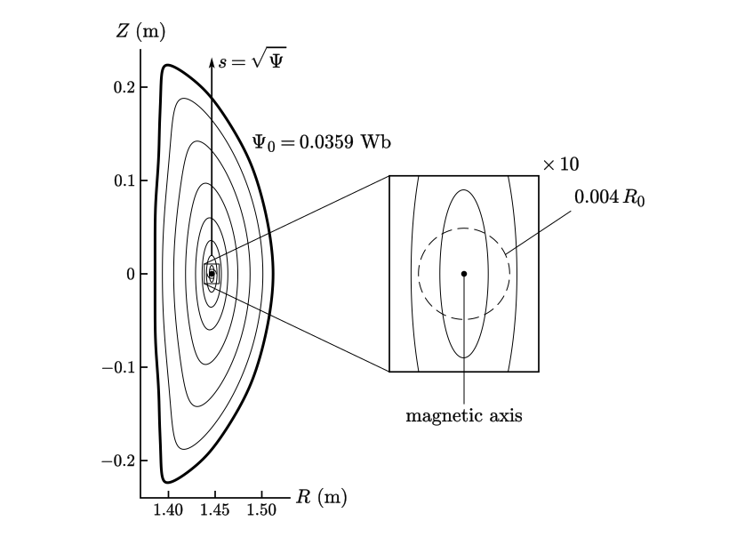

# The method

torux computes a vacuum flux surface as what it is: an invariant torus of the field-line flow. The surface is a Fourier series in two angles, the cylindrical angle $\varphi$ and the poloidal angle $\theta$ in which field lines are straight. Its coefficients and its rotational transform $\iota$ are the unknowns of one square system of equations, solved by Newton's method on the Biot-Savart field of the coils. It is the solution of an equation, by a spectral method: no finite elements, no fit to traced field lines, and not the minimum of anything. The series is lengthened until the field crossing the surface, measured at points the solve never used, stops falling, which is at rounding error. Where no surface encloses the flux asked for, torux proves it, or says that it could not decide.

The code is `src/torux`, each module's docstring holds the detail, and [`docs/code.md`](../docs/code.md) is the map.

## 1. A Fourier series in which field lines are straight

<picture>
  <source media="(prefers-color-scheme: dark)" srcset="figures/surface-a-dark.svg">
  
</picture>

**Fig. 1.** The flux surface of HSX's coils at 0.0359 Wb, $\iota=1.0855$, one twelfth cut away, and the square of its two angles. The net on the solid is the square's grid: $\theta$ and $\varphi$ every $2\pi/12$. Heavy: one field line, which is a straight line of slope $\iota$ in the square. An independent tracer that follows it through the coils' field for the nine tenths of a turn drawn stays within $4\times10^{-15}$ m of the series.

For a stellarator-symmetric source the surface is

```math
R(\theta,\varphi)=\sum_{m=0}^{M}\sum_{n=-N}^{N}R_{mn}\cos(m\theta-nN_{\mathrm{fp}}\varphi),\qquad
Z(\theta,\varphi)=\sum_{m=0}^{M}\sum_{n=-N}^{N}Z_{mn}\sin(m\theta-nN_{\mathrm{fp}}\varphi),
```

the series of VMEC's `RBC` and `ZBS` and of SIMSOPT's `SurfaceRZFourier`, which is how `s.save("input.name")` hands it to VMEC, DESC and SIMSOPT, whole or cut to the `mpol` and `ntor` asked for. $\varphi$ is the cylindrical angle. $\theta$ is not free: it is the straight-field-line angle that goes with $\varphi$, the PEST angle, VMEC's $\theta^{\ast}=\theta+\lambda$ and DESC's `theta_PEST`. A field line on the surface is then $\theta=\theta_0+\iota\varphi$, and following it is the derivative $\partial_\varphi+\iota\,\partial_\theta$. That is the whole equation, closed by the toroidal flux $\Psi_0$ asked for:

```math
\left(\frac{\partial}{\partial\varphi}+\iota\,\frac{\partial}{\partial\theta}\right)
\begin{pmatrix}R\\ Z\end{pmatrix}
=\frac{R}{B_\varphi}\begin{pmatrix}B_R\\ B_Z\end{pmatrix},
\qquad
-\oint\mathbf{A}\cdot\frac{\partial\mathbf{X}}{\partial\theta}\,d\theta=\Psi_0 .
```

The right side is the Biot-Savart integral over the coils, evaluated at the surface's own points at every Newton step with no grid of $\mathbf{B}$ in between, and it asks only that $B_\varphi$ keep one sign there. Both sides are projected on the modes of the series, on a grid of about $2.5M$ by $2.5N$ points to a field period. That gives as many equations as unknowns: at $M, N = 48, 32$ there are 6,306 of each. $\iota$ is one of the unknowns. It is not measured afterwards from a traced line: it comes out of the solve with the coefficients, to the same digits.

The system is square because the angle is pinned. $\mathbf{B}\cdot\mathbf{n}=0$ alone is one condition on two functions, and every reparameterisation of a solution is another solution. A quadratic-flux-minimising surface (Dewar, Hudson and Price, 1994) minimises $\int(\mathbf{B}\cdot\mathbf{n})^2$ with that freedom left in: where a flux surface exists it is the same surface, and its minimiser is not unique. Here the equation has two components, and the second admits only the parameterisation in which lines are straight, with the origin of $\theta$ fixed by stellarator symmetry. So Newton's method applies as it stands.

## 2. No starting guess: from the magnetic axis outward

<picture>
  <source media="(prefers-color-scheme: dark)" srcset="figures/start-dark.svg">
  
</picture>

**Fig. 2.** HSX from its 48 coils alone, in the plane $\varphi=0$. Dot: the magnetic axis. Inset, ten times larger: the circle of radius $0.004\,R_0$ the solve starts from (dashed), and the ellipse Newton's method makes of it in five iterations. Thin: the surfaces of the continuation, eight with the first and the last, at the solver's own steps in $s=\sqrt{\Psi}$, with no step refused. Heavy: the last, the surface asked for, $\iota=1.0855$, then refined to $M, N = 192, 96$ and $|\mathbf{B}\cdot\mathbf{n}|/|B|=3.0\times10^{-15}$.

The magnetic axis is a closed field line, so it is found the same way one dimension down: a Fourier curve $(R, Z)(\varphi)$ that solves $dR/d\varphi=RB_R/B_\varphi$, $dZ/d\varphi=RB_Z/B_\varphi$, by Newton's method from circles at a few radii about the coils' median radius. Its monodromy comes from the variational equation along the converged line, so Greene's residue and the transform on axis need no tracing either.

Next to the axis the equation is nearly linear, and Newton's method turns a circle of radius $0.004\,R_0$ about it into the first surface. From there the surfaces are followed outward in $s=\sqrt{\Psi}$: each is extrapolated from the ones before and corrected by Newton at the next flux, with the step halved when that fails. A low-order island chain stops such steps. torux then finds the chain's closed lines and jumps it, solving for a torus of given $\iota$ on the far side, with the flux equation exchanged for $\iota=\mathrm{const}$. At the flux asked for the continuation ends and the refinement of the next section begins.

A source that comes with surfaces, as a QUASR design does, skips all this: its stored surfaces are carried into the solver's angles and Newton starts from them. Where neither start reaches the request, traced lines supply a starting torus (`torux.seeds`), and the same Newton and the same acceptance follow.

## 3. Everything converges geometrically, so it is run to the floor

<picture>
  <source media="(prefers-color-scheme: dark)" srcset="figures/floor-dark.svg">
  
</picture>

**Fig. 3.** The spectrum of one verified surface, QUASR 954 at 4.5 times its design flux: at each $m$ the largest coefficient over $n$, relative to $m=1$. It falls a decade every 15 $m$, with a spike at each resonance $m\iota\approx nN_{\mathrm{fp}}$. Circles: $|\mathbf{B}\cdot\mathbf{n}|/|B|$ off the grid at the three levels of its refinement. Dashed: the solver's fit to the spectrum it had at $M=80$, which reaches the floor near $m=229$. It may at most double, so it goes to 160, fits again, and ends at 224 with $1.6\times10^{-15}$. Hatched: what no surface written in double precision reads below, $3.9\times10^{-16}$.

Coils are analytic curves and their vacuum field is analytic, so the surface is too, and each of the solve's three errors falls at least geometrically:

- **The field.** On a closed filament the $N$-point trapezoid rule for the Biot-Savart integral has an error like $e^{-2\pi N\alpha}$, with $\alpha$ set by the distance to the coil. $N$ is chosen for each coil, and every accepted surface carries the check: the rule on every second node must agree to $10^{-8}$ of $|B|$, and the error of the full rule is then the square of that. Sums are compensated (Neumaier). Segments, dipoles and rings have closed forms, written to avoid cancellation.
- **The series.** The coefficients fall geometrically in $m$ and $n$ (Fig. 3), so every digit costs the same number of modes as the one before, and the field crossing a truncated surface is that of the coefficients it lacks. The solver reads the rate off the surface it has, predicts the $M, N$ at which the series reaches the floor, and goes there, at most doubling each time.
- **Newton's method**, on the exact Jacobian of the projected system: by GMRES without forming it, or by a dense solve when the system is small. The preconditioner is where the angles pay. In straight-field-line angles the linearised equation is, to the accuracy of the surface in hand, triangular with $\partial_\varphi+\iota\,\partial_\theta$ on its diagonal, so its inverse is two magnetic differential equations: an FFT, and a division by $i(m\iota-nN_{\mathrm{fp}})$.

Refinement ends when the largest $|\mathbf{B}\cdot\mathbf{n}|/|B|$ on a grid shifted half a cell from the one the solve used reaches $3\times10^{-15}$, or stops halving. A torus that ends above $10^{-14}$ is not called a surface. One that passes goes to a second program that shares no code with the solver and measures it again at 4,096 random points: [what is checked, and by what](../docs/verification.md). In the comparison on the [front page](../README.md) the whole solve takes 4.2 s in the median, and [every refinement of its 201 surfaces](../results/README.md#refinementcsv) reaches between $5\times10^{-16}$ and $7\times10^{-15}$.

## 4. Where there is no surface, a proof

A small $|\mathbf{B}\cdot\mathbf{n}|$ on a truncated series is not yet a surface: a thin island chain at a harmonic the series does not carry leaves it small. So before a torus is accepted, the forcing it leaves at every near-resonant harmonic $(m, n)$ up to $m=2M+10$ and the local shear give the half-width of the chain that forcing opens, and the torus must lie at least two half-widths outside every one (`torux.guard`).

When no torus at the request passes, torux looks for the reason and tries to prove it. There are two theorems, each about every flux surface around the axis and not about any computed one.

<picture>
  <source media="(prefers-color-scheme: dark)" srcset="figures/island-band-dark.svg">
  
</picture>

**Fig. 4.** The certificate of QUASR 219457, whose requested flux falls in the chain at $\iota=-1/5$: 15 islands, 26 µm wide, in a cross-section 0.13 m wide. Right: the plane $\varphi=0$ at true scale, where the chain is a hairline. Left: three of its islands, drawn 500 times wider across than along. Solid: unstable arcs from the X points. Dashed: their mirror images, stable arcs. They meet on $Z=0$ (open circles) and close into two curves, of flux 0.006917 and 0.006922 Wb. No flux surface encloses a flux between those (cross-hatched), and the request is 0.006920 Wb.

**Island band** (`torux.islandband`). For a stellarator-symmetric source the period map $P$ of a symmetry plane is reversible: $SPS=P^{-1}$ with $S(R,Z)=(R,-Z)$. The mirror image of an unstable branch of an X point is then a stable branch of the mirrored X point, and a point of the unstable branch on the line $Z=0$ is its own mirror image, so it lies on both: an exact heteroclinic point, however thin the chain. Unstable arcs to such points and their mirrored stable arcs close into two curves around the axis. A flux surface encloses both, lies inside both, or is one of them, so none encloses a flux between theirs. The error tube of the traced arcs and the quadrature error enter the interval.

<picture>
  <source media="(prefers-color-scheme: dark)" srcset="figures/edge-dark.svg">
  
</picture>

**Fig. 5.** The certificate of QUASR 1100073, in the plane $\varphi=0$. Thin rings: surfaces torux finds, the outermost verified at 0.0506 Wb. Crosses: a closed field line of period 11 beyond them. Heavy: its unstable arcs (solid) and stable arcs (dashed), joined at their eleven crossings into a curve that every flux surface lies inside, so none encloses more than 0.06113 Wb. Thin dashed: the surface stored with the design, which encloses the 0.0695 Wb asked for and lies wholly outside. Small view: the same plane at a fifth of the scale, where the branches of that line leave, on their way to a point (dot) whose field line reaches $B_\varphi<0$.

**Edge barrier** (`torux.barrier`). $RB_\varphi$ is harmonic in vacuum, so by the maximum principle a field line that reaches $B_\varphi<0$ lies outside every flux surface. Beyond the last surface torux finds a hyperbolic closed line with a manifold branch that reaches such lost points, and shows that no surface passes through it. Its unstable and stable arcs, joined where they cross, close a curve around the axis. Every surface lies inside that curve, so its flux plus its error terms is an upper bound. Some of those terms are strict bounds and some are validated models, which makes this the weaker of the two certificates.

Both are theorems whose hypotheses are established numerically, with an error budget measured in the same call: neither is interval arithmetic or a machine-checked proof, and [verification](../docs/verification.md) says what that means in practice. Sources that are not stellarators are settled by classical arguments (`torux.nonstell`): with no toroidal field there is no toroidal flux to enclose, in an axisymmetric vacuum the maximum principle for $\Delta^{\ast}\psi$ leaves no interior extremum, and Ampère's law excludes a surface that links no current. Everything else is `undetermined`, with what was found and what was tried, and never a guess.

## 5. Gradients, and coils without stellarator symmetry

The Jacobian $J$ of the converged system is already in hand, so an adjoint costs one more linear solve: $J^{\mathsf T}\lambda=\partial f/\partial u$, then $df/dp=-\lambda^{\mathsf T}\,\partial F/\partial p$ for every coil coefficient and current $p$ at once, the last product being one reverse pass through the Biot-Savart sum. `gradients=True` returns $d\iota/dp$ this way, and `s.system` and `s.vjp` hand $J$ and that product to an optimiser's own adjoint, in the unknowns of a `SurfaceRZFourier`: [usage](../docs/usage.md#the-equations-at-any-surface). They agree with central differences to $10^{-5}$ or better (`tests/test_gradients.py`). A source with field periods or stellarator symmetry is solved on one period and these are the derivatives of that solve: exact for every change that keeps the symmetry, and for one coil of a symmetric set only when summed over its copies.

Without stellarator symmetry the series carries cosines and sines for both $R$ and $Z$, and two things come loose that the symmetry held: the origin of $\theta$, and one equation, which the others imply because the flux of $\mathbf{B}$ out of a closed surface is zero. A phase condition takes the first and a multiplier the second, and the system is square again (`torux.torus_general`, `s.system_general`).

## What is known already

The equation is the parameterisation method for invariant tori of Haro and de la Llave. Other ways to compute invariant tori, from the trajectories themselves: Ruth and Bindel ([2023](https://arxiv.org/abs/2312.00967)), Ruth, Kulik and Burby ([2025](https://arxiv.org/abs/2505.08715)), and, with the parameterisation method, Blessing and Mireles James ([2023](https://arxiv.org/abs/2306.16597)). SIMSOPT's BoozerExact and BoozerLS surfaces (Giuliani and others, 2022) solve a related problem in Boozer angles, and a quadratic-flux-minimising surface (Dewar, Hudson and Price, 1994) is the surface of section 1 with its parameterisation left free. Converse KAM results on non-existence: Kallinikos, MacKay and Martinez-del-Rio ([2023](https://arxiv.org/abs/2304.09613)). What torux adds is the combination: rounding-level surfaces with a check that shares no code, certificates of absence, and a refusal to answer otherwise, in one call that runs unattended over a whole database.

Every figure here is drawn from torux's own output by the script of its name in [`figures/`](figures): `python method/figures/floor.py`.
