# Any coil: the twelve

Twelve kinds of magnetic source, one solver. Nine hold vacuum flux surfaces, and each is drawn with the surface torux verified for it, as light. Three hold none that encloses toroidal flux, and torux proves it: the thin grey lines are their field lines.

The coils and magnets are drawn where their files put them, as copper. The tarnish and the soft sheen are decoration and carry no data. Every number below is in [`sources.json`](sources.json), with the checksum and origin of every file.

The picture of all twelve is not part of the repository's CC0 dedication, and six of the renderings below (LHD, CNT, the wireframe, MUSE, ITER, the dipole) stay under the licences of the files they are drawn from: [credits](../NOTICE.md#behind-the-pictures).

## 1. QUASR 0124533

<picture>
  <source media="(prefers-color-scheme: dark)" srcset="sources/qa-dark.png">
  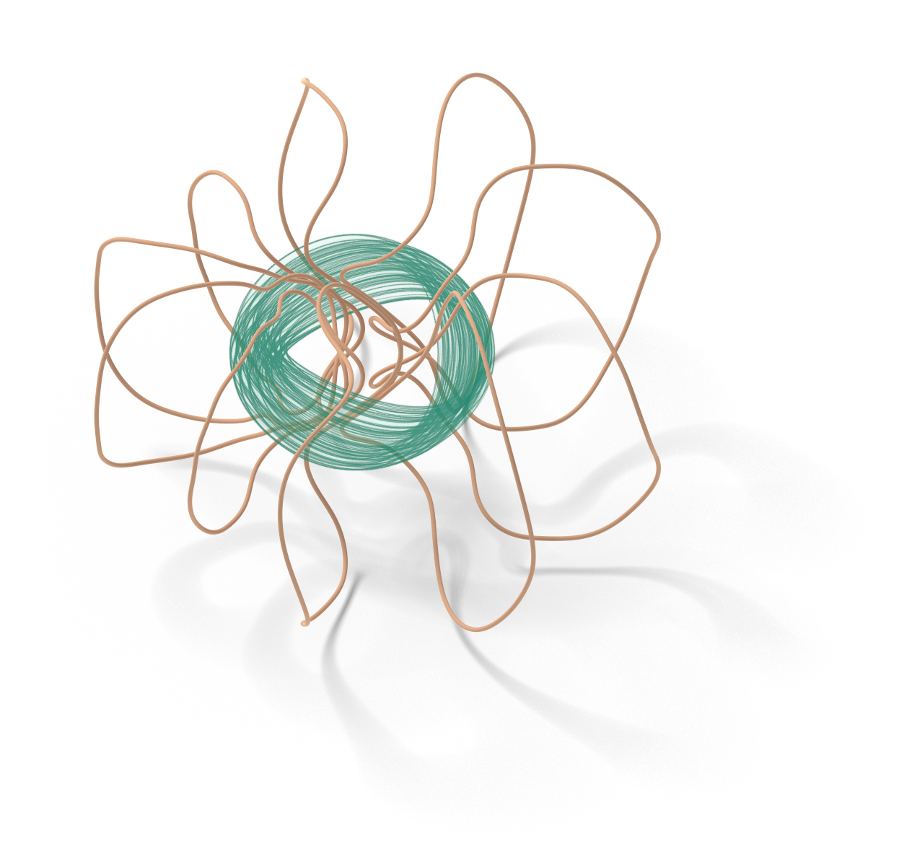
</picture>

A design from QUASR: ten coils, one field period. Read with `torux.load("serial0124533.json")`.

**Surface verified:** 0.110336 Wb of toroidal flux, rotational transform -0.294533. The field crosses it by at most 1.1 × 10⁻¹⁵ of its strength by the solver's check and 1.0 × 10⁻¹⁵ by the independent evaluator's, and two field lines traced independently for 40 field periods stay within 4.4 × 10⁻¹⁴ of its minor radius.

QUASR v4, the QUAsisymmetric Stellarator Repository, by Andrew Giuliani (MIT): [doi:10.5281/zenodo.13717741](https://doi.org/10.5281/zenodo.13717741).

## 2. HSX

<picture>
  <source media="(prefers-color-scheme: dark)" srcset="sources/qh-dark.png">
  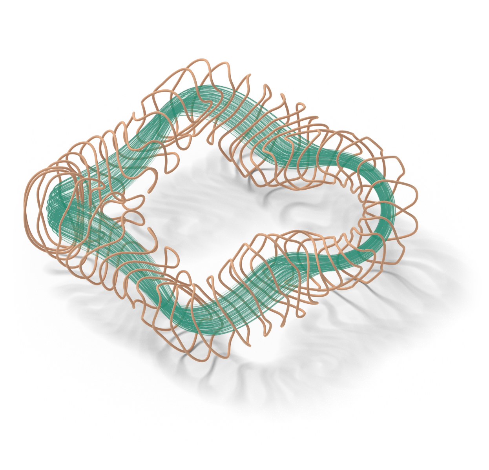
</picture>

The Helically Symmetric eXperiment in Wisconsin: 48 modular coils. Read with `torux.load("hsx.json")` (here: [`examples/hsx.json`](../examples/hsx.json)).

**Surface verified:** 0.0359221 Wb of toroidal flux, rotational transform 1.08551. The field crosses it by at most 3.0 × 10⁻¹⁵ of its strength by the solver's check and 2.2 × 10⁻¹⁵ by the independent evaluator's, and two field lines traced independently for 40 field periods stay within 1.1 × 10⁻¹³ of its minor radius.

HSX coil set from simsopt 1.11 (hiddenSymmetries/simsopt), in torux's Fourier-filament form (MIT): [github.com/hiddenSymmetries/simsopt](https://github.com/hiddenSymmetries/simsopt).

## 3. Wendelstein 7-X

<picture>
  <source media="(prefers-color-scheme: dark)" srcset="sources/qi-dark.png">
  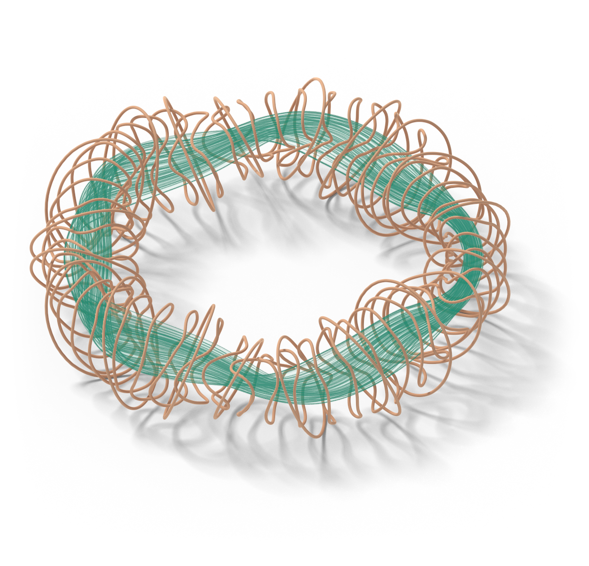
</picture>

Wendelstein 7-X in Greifswald: 50 non-planar coils and 20 planar ones, which carry no current in this, its standard configuration. Read with `torux.load("w7x.json")` (here: [`examples/w7x.json`](../examples/w7x.json)).

**Surface verified:** 2.21743 Wb of toroidal flux, rotational transform 0.979427. The field crosses it by at most 4.3 × 10⁻¹⁵ of its strength by the solver's check and 3.8 × 10⁻¹⁵ by the independent evaluator's, and two field lines traced independently for 40 field periods stay within 1.3 × 10⁻¹² of its minor radius.

Wendelstein 7-X coil set from simsopt 1.11 (hiddenSymmetries/simsopt), in torux's Fourier-filament form (MIT): [github.com/hiddenSymmetries/simsopt](https://github.com/hiddenSymmetries/simsopt).

## 4. LHD

<picture>
  <source media="(prefers-color-scheme: dark)" srcset="sources/heliotron-dark.png">
  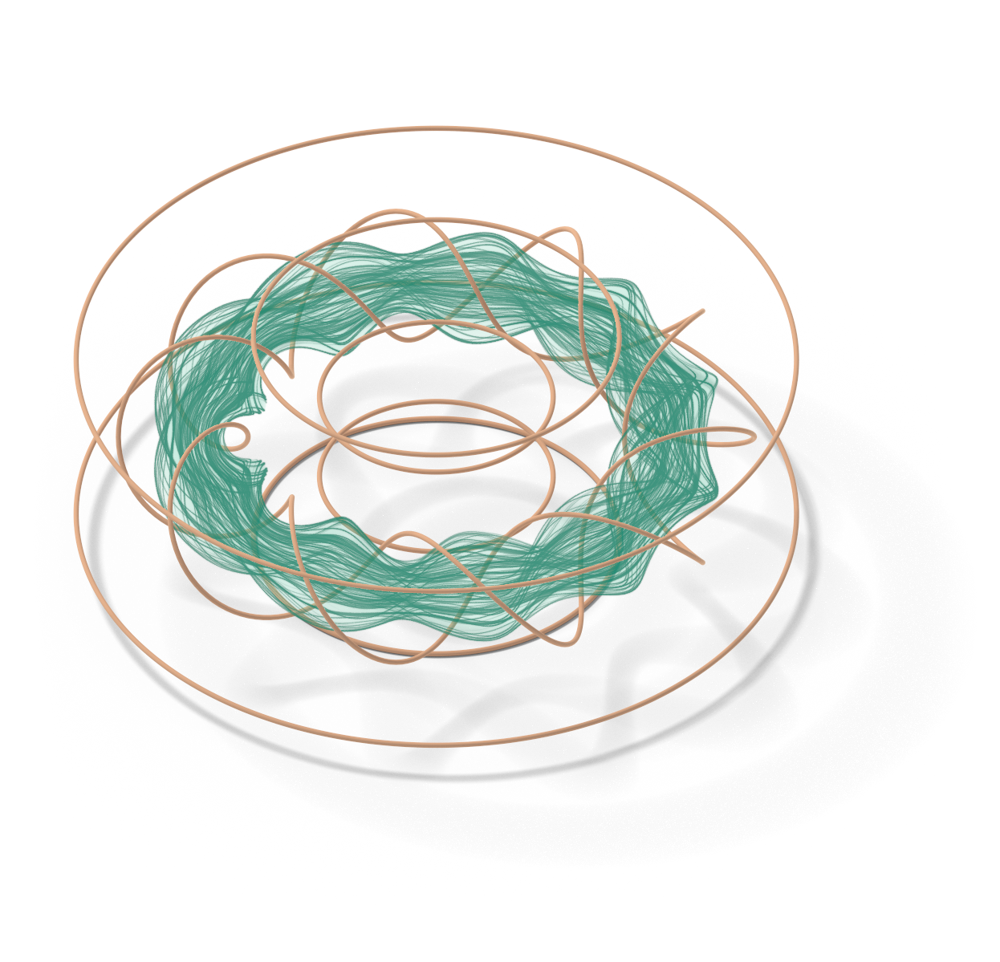
</picture>

The Large Helical Device in Japan: two helical coils and six circular ones. Read with `torux.load("coils.lhd")`.

**Surface verified:** 3.18596 Wb of toroidal flux, rotational transform -1.36708. The field crosses it by at most 3.6 × 10⁻¹⁵ of its strength by the solver's check and 2.8 × 10⁻¹⁵ by the independent evaluator's, and two field lines traced independently for 40 field periods stay within 2.6 × 10⁻¹³ of its minor radius.

LHD coil model (Y. Suzuki, 2017) from the FOCUS code's examples (PrincetonUniversity/FOCUS) (GPL-3.0): [github.com/PrincetonUniversity/FOCUS](https://github.com/PrincetonUniversity/FOCUS).

## 5. CNT

<picture>
  <source media="(prefers-color-scheme: dark)" srcset="sources/interlinked-dark.png">
  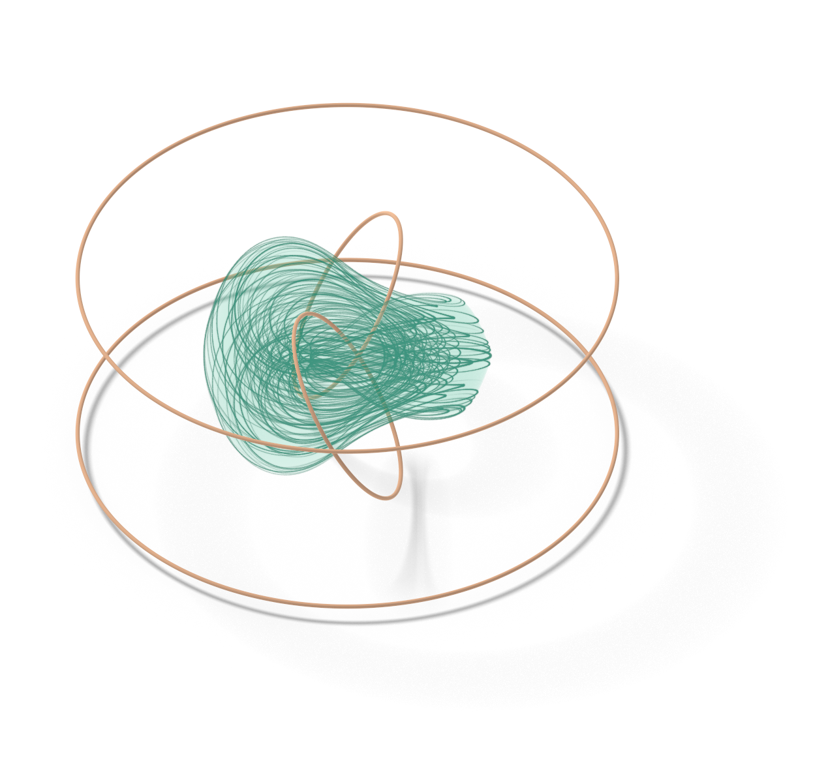
</picture>

The Columbia Non-neutral Torus: two interlinked coils and two circular ones. Read with `torux.load("biotsavart_cnt32_symm.json")`.

**Surface verified:** 0.022405 Wb of toroidal flux, rotational transform -0.24464. The field crosses it by at most 1.7 × 10⁻¹⁵ of its strength by the solver's check and 1.3 × 10⁻¹⁵ by the independent evaluator's, and two field lines traced independently for 40 field periods stay within 3.4 × 10⁻¹⁴ of its minor radius.

CNT coil set from "Update on the design of the Columbia Stellarator eXperiment" by A. Baillod, R. Lopez, A. Veksler, M. Campagna, D. Schmeling, E. Paul and A. Knyazev (CC BY 4.0): [doi:10.5281/zenodo.18115389](https://doi.org/10.5281/zenodo.18115389).

## 6. STAR_Lite-A

<picture>
  <source media="(prefers-color-scheme: dark)" srcset="sources/lt-dark.png">
  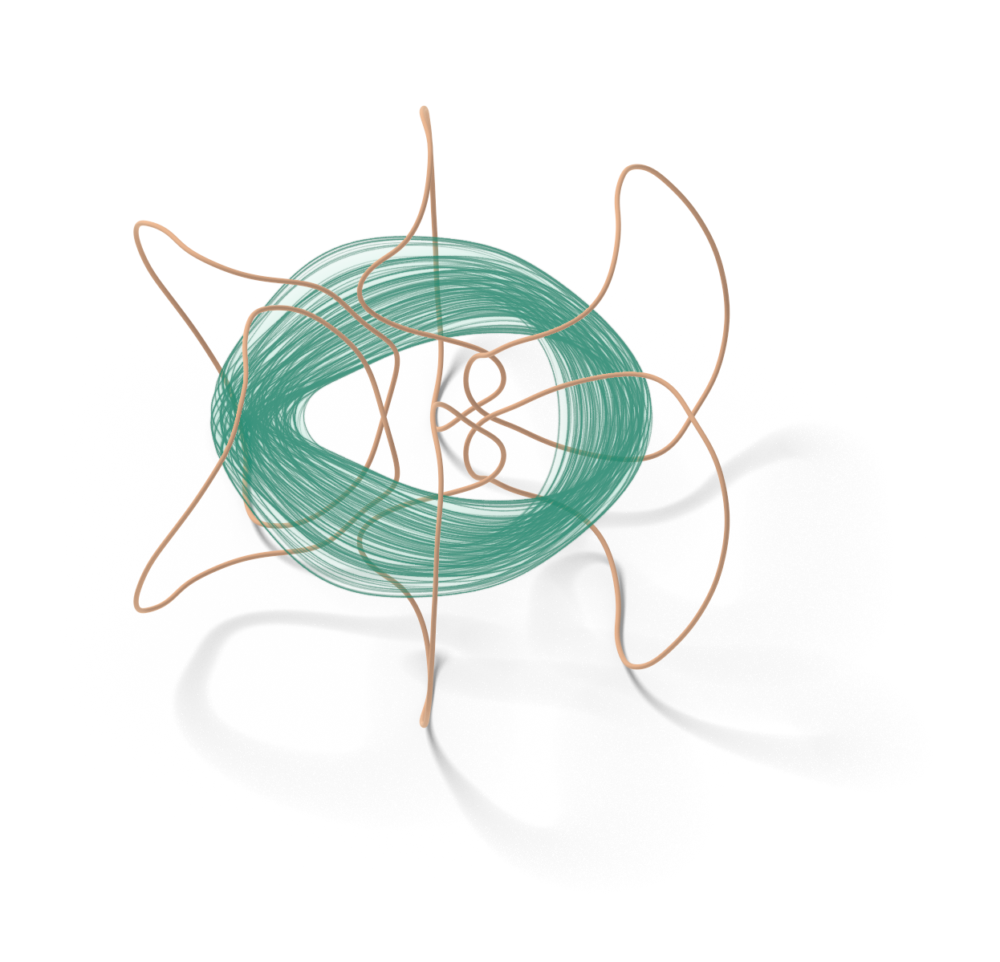
</picture>

STAR_Lite: six coils of two shapes, an L and a T. Read with `torux.load("STAR_Lite-A.json", which="BiotSavart1")`.

**Surface verified:** 0.00246685 Wb of toroidal flux, rotational transform -0.109957. The field crosses it by at most 1.2 × 10⁻¹⁵ of its strength by the solver's check and 1.0 × 10⁻¹⁵ by the independent evaluator's, and two field lines traced independently for 40 field periods stay within 7.0 × 10⁻¹⁴ of its minor radius.

STAR_Lite-A coil set (Harrer, Giuliani, Padidar, Davies, Naik and Lowe, 2026) shipped in simsopt's configs (MIT): [github.com/hiddenSymmetries/simsopt](https://github.com/hiddenSymmetries/simsopt).

## 7. wireframe (RCLS)

<picture>
  <source media="(prefers-color-scheme: dark)" srcset="sources/wireframe-dark.png">
  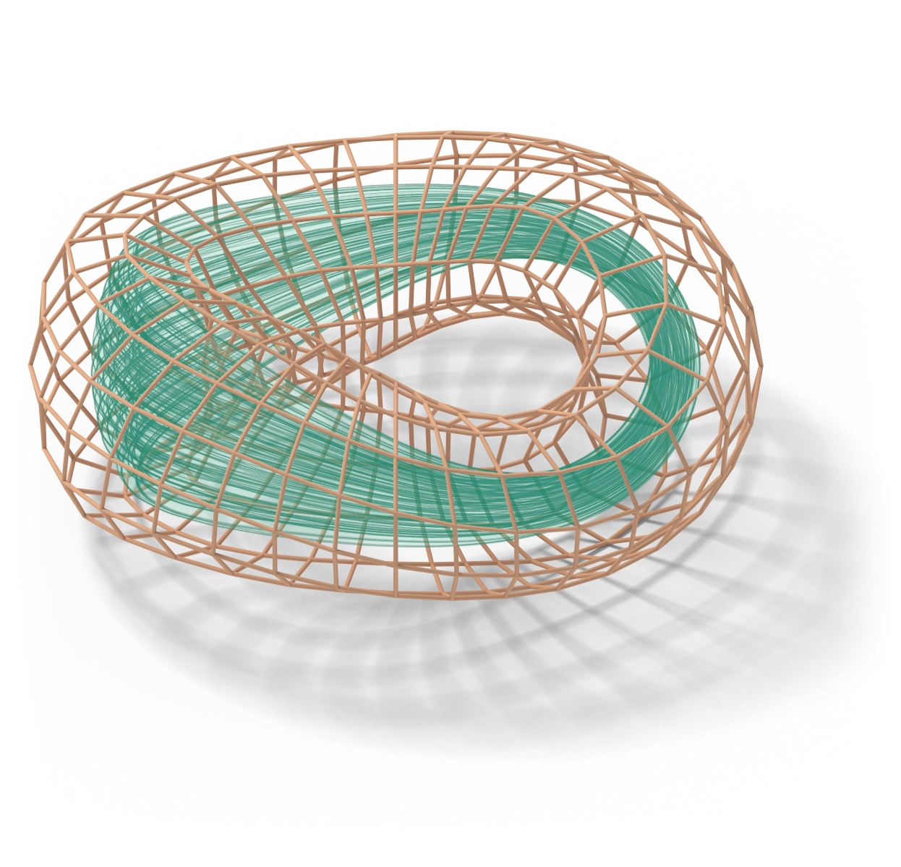
</picture>

A wireframe: 768 straight segments of current on a grid around the plasma. Read with `torux.load("wf_data_fulltorus.csv", nfp=2)`.

**Surface verified:** 0.138164 Wb of toroidal flux, rotational transform 0.405334. The field crosses it by at most 1.8 × 10⁻¹⁵ of its strength by the solver's check and 1.5 × 10⁻¹⁵ by the independent evaluator's, and two field lines traced independently for 40 field periods stay within 6.8 × 10⁻¹⁴ of its minor radius.

wireframe from "Data and code for A framework for discrete optimization of stellarator coils" by Kenneth Hammond (CC BY 4.0): [doi:10.34770/6pbm-9981](https://doi.org/10.34770/6pbm-9981).

## 8. MUSE

<picture>
  <source media="(prefers-color-scheme: dark)" srcset="sources/magnets-dark.png">
  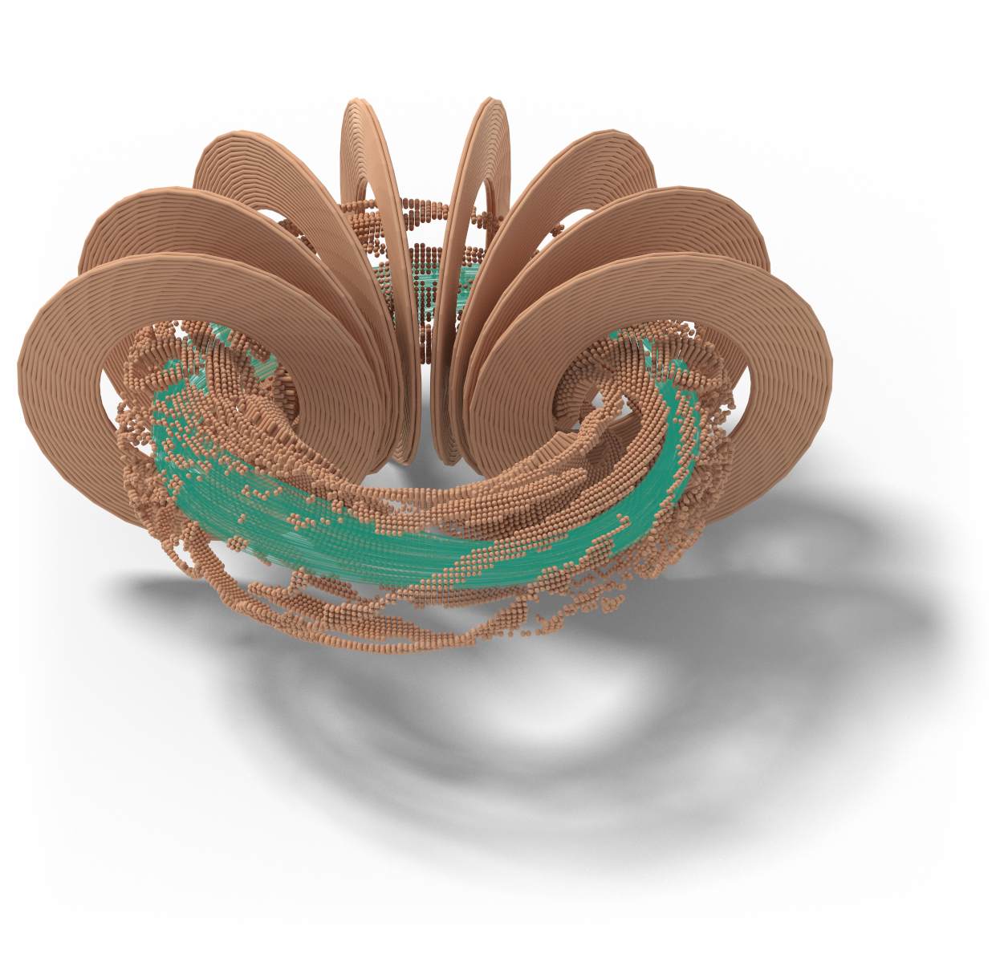
</picture>

MUSE at Princeton: 16 planar coils and 50,736 permanent magnets. Drawn cut away: the coils nearest the viewer are left out. Read with `torux.load("muse_original.coils", "zot43-dipoles-clip.focus", nfp=2)`.

**Surface verified:** 0.000589713 Wb of toroidal flux, rotational transform 0.198812. The field crosses it by at most 6.8 × 10⁻¹⁵ of its strength by the solver's check and 6.1 × 10⁻¹⁵ by the independent evaluator's, and two field lines traced independently for 40 field periods stay within 7.2 × 10⁻¹⁴ of its minor radius.

MUSE zot43 magnet and coil model from the "QUADCOIL Quasi-single-stage Dataset" by Lanke Fu (CC BY 4.0): [doi:10.5281/zenodo.19923438](https://doi.org/10.5281/zenodo.19923438).

## 9. US131 (umbilic)

<picture>
  <source media="(prefers-color-scheme: dark)" srcset="sources/umbilic-dark.png">
  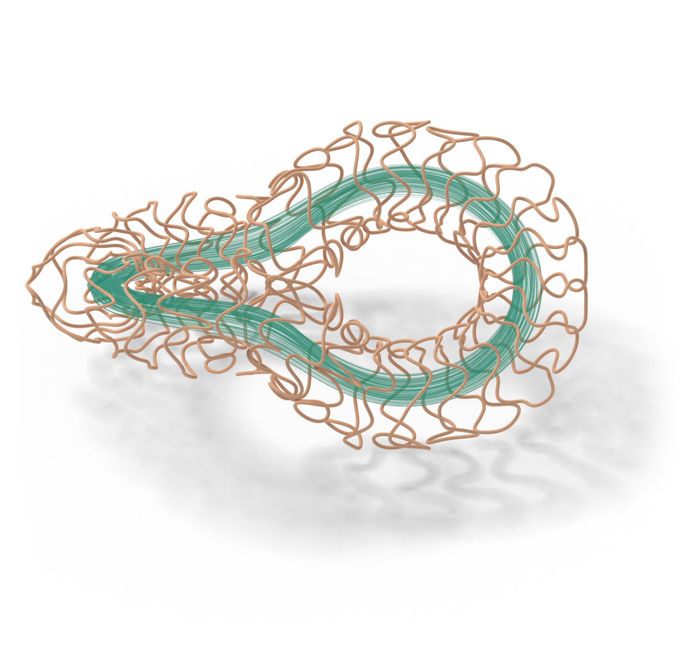
</picture>

An umbilic stellarator, US131: 32 coils. Read with `torux.load("optimized_coilset9.h5")`.

**Surface verified:** 0.0635282 Wb of toroidal flux, rotational transform 0.325766. The field crosses it by at most 1.6 × 10⁻¹⁵ of its strength by the solver's check and 1.1 × 10⁻¹⁵ by the independent evaluator's, and two field lines traced independently for 40 field periods stay within 1.0 × 10⁻¹³ of its minor radius.

US131 coil set from "Omnigenous umbilic stellarators: data and analysis files" by Rahul Gaur (MIT): [doi:10.5281/zenodo.15355215](https://doi.org/10.5281/zenodo.15355215).

## 10. ITER

<picture>
  <source media="(prefers-color-scheme: dark)" srcset="sources/tokamak-dark.png">
  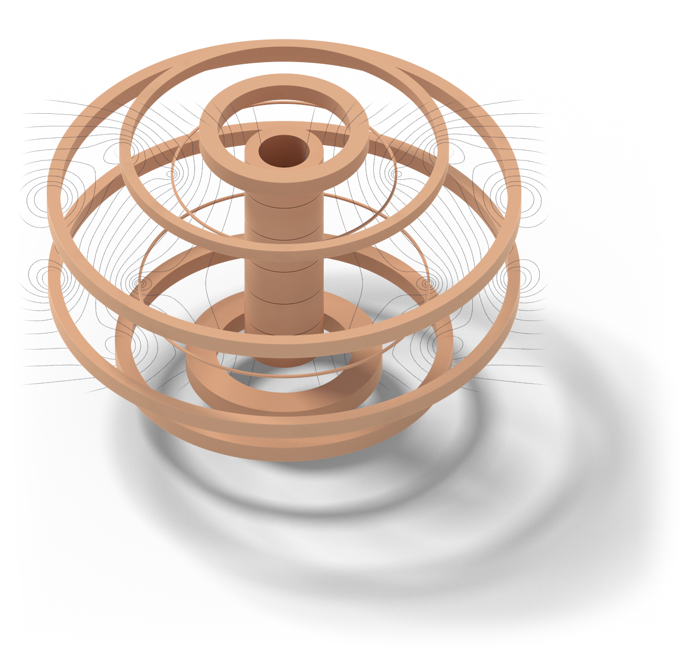
</picture>

ITER's poloidal coils: six central-solenoid modules, six poloidal-field coils, two vertical-stability coils. Read with `torux.load("ITER_mesh.h5")`.

**No surface, by proof.** These coils make no toroidal field: each of their field lines stays in its own vertical plane, closing round the conductors, and nothing goes round the machine. The toroidal-field coils would not change the answer: by the maximum principle an axisymmetric vacuum field has no closed surfaces away from its conductors. A tokamak's surfaces need the current in its plasma. The grey lines are the field of unit currents in the coils.

ITER coil geometry of the TokaMaker examples (OpenFUSIONToolkit) (LGPL-3.0): [github.com/OpenFUSIONToolkit/OpenFUSIONToolkit](https://github.com/OpenFUSIONToolkit/OpenFUSIONToolkit).

## 11. DIII-D upper I-coils

<picture>
  <source media="(prefers-color-scheme: dark)" srcset="sources/rmp-dark.png">
  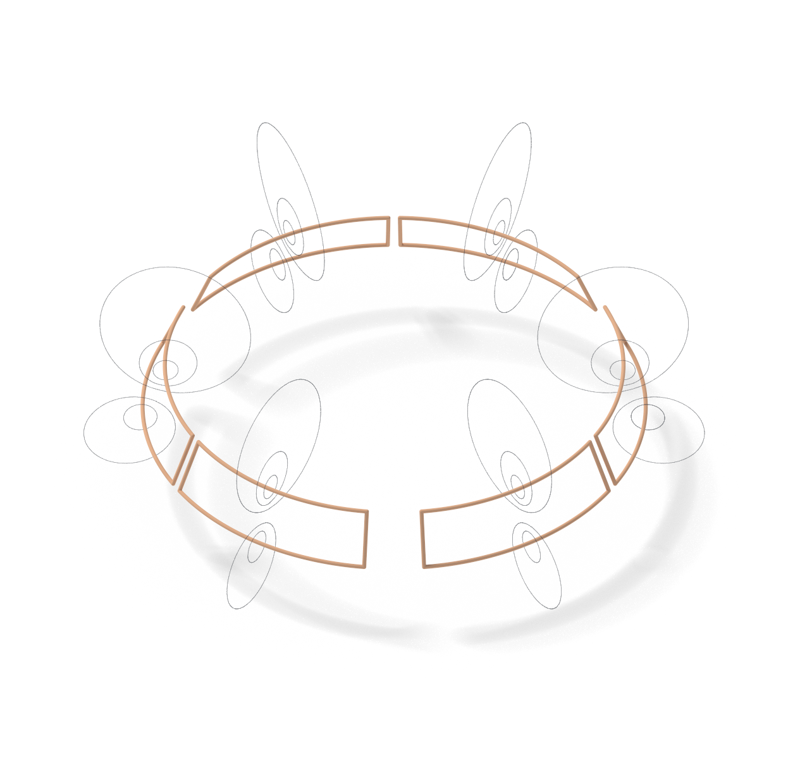
</picture>

The upper row of DIII-D's I-coils: six window-frame coils that perturb a tokamak's field. Read with `torux.load("d3d_iu.dat")` (here: [`examples/d3d_icoils_upper.dat`](../examples/d3d_icoils_upper.dat)).

**No surface, by proof.** With equal currents the six coils are antisymmetric under a mirror plane through the machine's axis, so the field has no component across that plane and no line passes through it: nothing goes round the machine. Ampère's law and the coils' shadows exclude surfaces a second way. The grey lines are field lines of the six coils, each closing round a conductor.

DIII-D upper I-coil geometry of the GPEC coil library (OpenFUSIONToolkit/GPEC) (MIT): [github.com/OpenFUSIONToolkit/GPEC](https://github.com/OpenFUSIONToolkit/GPEC).

## 12. LDX-like dipole

<picture>
  <source media="(prefers-color-scheme: dark)" srcset="sources/dipole-dark.png">
  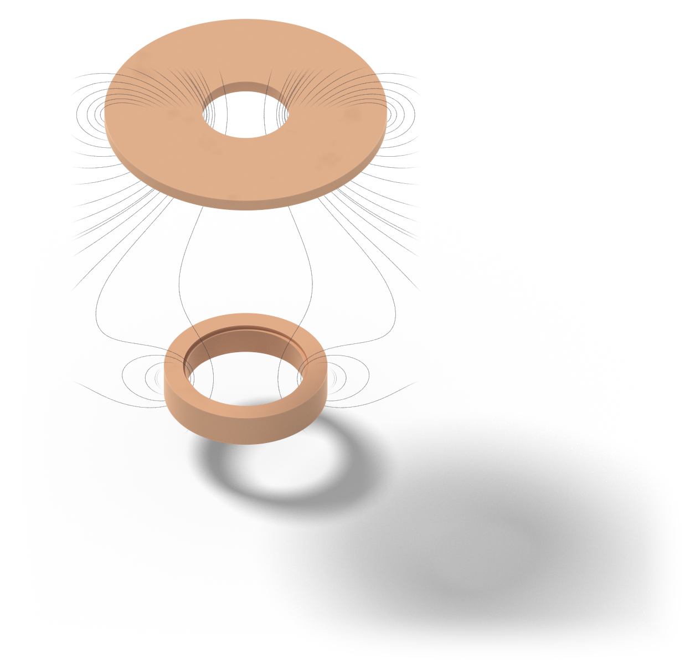
</picture>

A levitated dipole, after LDX: a floating ring and the coil that lifts it. Built in code from the two coils' cross-sections, as `kind="dipole"`.

**No surface that encloses toroidal flux, by proof.** Axisymmetric, with no toroidal field: every field line is a closed loop in a vertical plane round the floating ring. Those loops do hold a plasma, which is how a levitated dipole confines, but they go round the ring the short way and enclose no toroidal flux. The grey lines are the field of unit currents in the two coils.

LDX-like dipole of the TokaMaker examples (OpenFUSIONToolkit) (LGPL-3.0): [github.com/OpenFUSIONToolkit/OpenFUSIONToolkit](https://github.com/OpenFUSIONToolkit/OpenFUSIONToolkit).

# One field line

<picture>
  <source media="(prefers-color-scheme: dark)" srcset="one-line-dark.gif">
  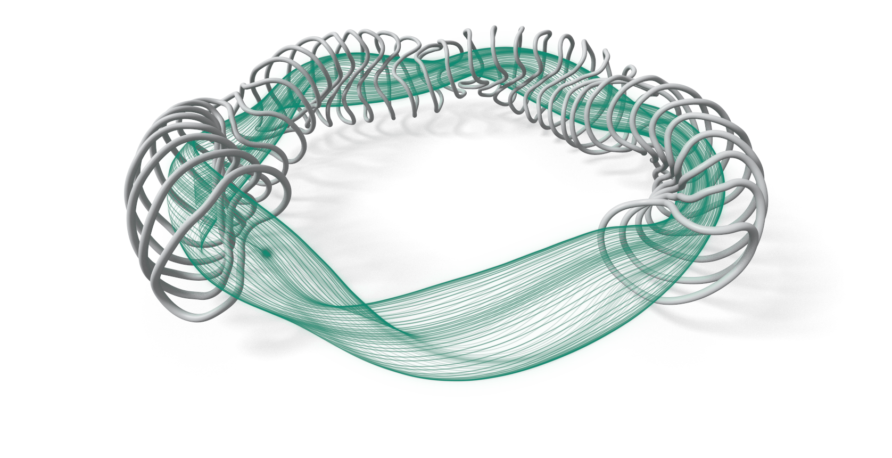
</picture>

One field line of the vacuum field of Wendelstein 7-X's coils, and the surface torux computes at 2.21743 Wb of toroidal flux. The coils are drawn cut away: those nearest the viewer are left out, and so are the 20 planar coils, which carry no current in this configuration. The line is followed for 200 laps (7.3 km) by a tracer that shares no code with the solver's field. Over them it stays within 1.1 × 10⁻¹³ m of the surface, 5.0 × 10⁻¹⁵ m in the median. The surface: 3.6 × 10⁻¹⁵ of the field's strength crosses it by the solver's check, 2.9 × 10⁻¹⁵ by the independent evaluator's. What each number is and how it was measured: [`one-line.json`](one-line.json).

The surface again, from the bundled coils: `torux solve examples/w7x.json --flux 2.217430801869203 --budget 3600`. On a 2012 Intel Xeon E5-4650 it comes back bit for bit as drawn, in 8 minutes on four threads, and another processor may differ in the last digit.

Wendelstein 7-X coil set from simsopt 1.11 (hiddenSymmetries/simsopt) (MIT): [github.com/hiddenSymmetries/simsopt](https://github.com/hiddenSymmetries/simsopt).
